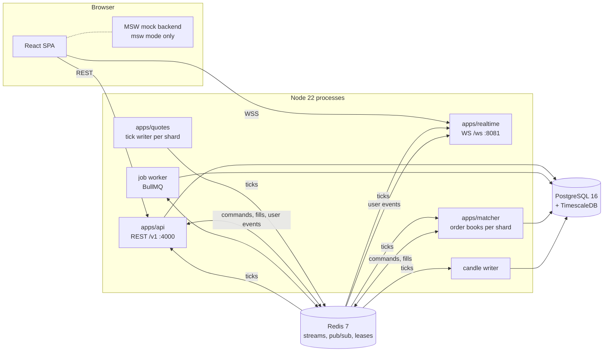
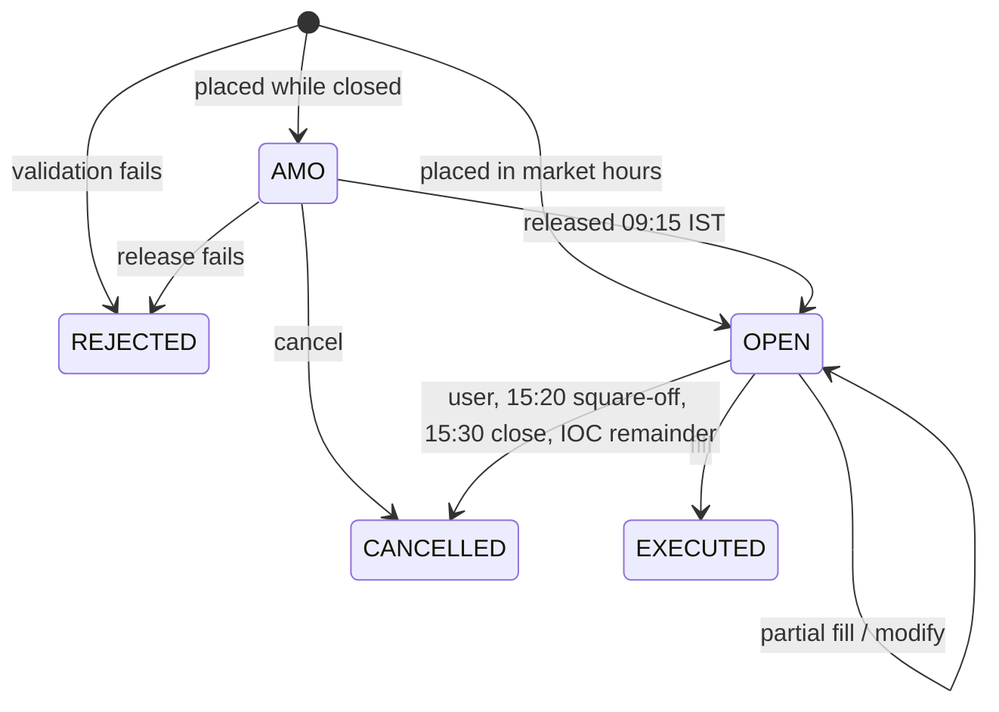

# nthstock: application context

| | |
|---|---|
| Document | CTX-1, the single-file context for the whole nthstock application |
| Version | 1.0 |
| Date | 2026-11-03 |
| Owner and approver | Naresh Payani |
| Describes | `develop` at `189bfda` (2 Nov 2026): Phase 1 and Phase 2 done, Wave 3 (E22 to E25), Trade from Charts (TFC-1), the craft round (CR-1) and the phone app shell built |
| Audience | A new engineer, reviewer or AI agent who needs the whole picture before changing anything |
| Related | [CLAUDE.md](../CLAUDE.md) · [architecture.md](architecture.md) (HLD-1) · [product.md](product.md) · [ADRs](adr/) · [specs](specs/) · [runbooks](runbooks/) · [DESIGN.md](../DESIGN.md) · [WRITEUP.md](../WRITEUP.md) · the in-app guide at `/guide` |

**How to use this document.** Read it once end to end; it takes about 25 minutes. It summarises
every part of the system and links to the document that owns the detail. Where this file and an
owning document disagree, the owning document wins (CLAUDE.md for rules and decisions,
architecture.md for design, the spec for a feature, the code for behaviour). Section numbers are
stable so a review comment can cite `application-context.md §7`.

## Contents

1. [What nthstock is](#1-what-nthstock-is)
2. [History and current status](#2-history-and-current-status)
3. [Owner decisions that shape everything](#3-owner-decisions-that-shape-everything)
4. [Product: what a user can do](#4-product-what-a-user-can-do)
5. [Architecture at a glance](#5-architecture-at-a-glance)
6. [Repository map](#6-repository-map)
7. [Frontend (`apps/web`)](#7-frontend-appsweb)
8. [Backend processes](#8-backend-processes)
9. [Trading domain](#9-trading-domain)
10. [Market data, mock feed and demo mode](#10-market-data-mock-feed-and-demo-mode)
11. [Identity, security and privacy](#11-identity-security-and-privacy)
12. [Data: PostgreSQL and Redis](#12-data-postgresql-and-redis)
13. [Design system and the phone experience](#13-design-system-and-the-phone-experience)
14. [Quality: tests, budgets and measured performance](#14-quality-tests-budgets-and-measured-performance)
15. [Environments, CI/CD and releases](#15-environments-cicd-and-releases)
16. [The agent team and how work flows](#16-the-agent-team-and-how-work-flows)
17. [Conventions](#17-conventions)
18. [Commands](#18-commands)
19. [Decision records](#19-decision-records)
20. [Known gaps, risks and what is next](#20-known-gaps-risks-and-what-is-next)
21. [Glossary](#21-glossary)
22. [Where to find more](#22-where-to-find-more)

---

## 1. What nthstock is

nthstock is an **Indian stock-market investing and paper-trading platform**. It has the
information architecture of the Paytm Money stocks dashboard and its own visual identity. Users
sign in with a mobile OTP, a device PIN and optional TOTP, watch live NSE and BSE prices, keep
watchlists, and trade with **₹10,00,000 of virtual cash**: market, limit and after-market orders,
intraday and delivery, partial fills, trailing stop-losses, trading directly from the chart, and a
one-tap scalper pad.

Three facts frame every design choice:

- **Paper trading only.** No real money moves and no broker is connected. The paper engine is the
  exchange.
- **Simulated market data.** About 5,000 equities and the major indices tick by a seeded random
  walk. A licensed feed can replace the simulator behind one adapter.
- **One product, two backends.** The same React app runs against a real backend (Fastify,
  PostgreSQL, Redis and four kinds of worker) or against a complete mock of that backend that runs
  inside the browser. The public demo is the second, so a reviewer needs no server.

| Link | What it is |
|---|---|
| https://github.com/nareshpayani/nthstock | Public repository (default branch `develop`) |
| https://nthstock-a13a5.web.app/login?try=1 | Live site: signs in to the demo and opens RELIANCE with a position and a trailing stop |
| https://nthstock-a13a5.web.app/dashboard?demo=1 | Live dashboard in demo mode (login 9000000001, OTP 123456) |
| https://nthstock-a13a5.web.app/guide | In-app documentation: architecture, low-level design, mock data, performance, agents, CI/CD, Demo 2 |
| https://nthstock-a13a5.web.app/demo/craftRecording.mp4 | Phone recording of the mobile trade-from-chart flow (1:38) |

## 2. History and current status

| When (2026) | What happened | Where it is recorded |
|---|---|---|
| 25 Sep | Product defined; seven rounds of requirement Q&A answered; decisions D1 to D11; repo created | [requirements-qa.md](requirements-qa.md) rounds 1 to 8, [CLAUDE.md §0](../CLAUDE.md) |
| 25 Sep to 28 Sep | **Phase 1** (E1 to E10, T-001 to T-175): monorepo, design system, dashboard, auth, watchlists, order ticket, orders, positions, holdings, funds, all on the MSW mock backend | [specs/README.md](specs/README.md), ADR 0001 to 0006 |
| 28 Sep | **Phase 2** approved: backend core on PostgreSQL (E11 to E21, T-176 to T-244) | [backend-core.md](specs/backend-core.md), ADR 0007 |
| 7 Oct | Repository reorganised; issue keys `NSTOCK-NNNN` and Conventional Commits scoped by key | ADR 0008 |
| 21 to 22 Oct | `develop` and `production` branches; Firebase hosting; agent-promoted releases | ADR 0010, 0011 |
| 22 to 25 Oct | **TFC-1**: Trade from Charts, trailing stop-loss orders (TSLO) and the scalper, built for the Paytm Money take-home | [trade-from-charts.md](specs/trade-from-charts.md), ADR 0012, [WRITEUP.md](../WRITEUP.md) |
| 24 to 25 Oct | Phase 2 finished (E15 to E21: paper accounts on Postgres, jobs, TOTP, sessions, DPDP, sign-off); tabbed `/guide` with a real load test | [phase2-asvs-l2.md](security/phase2-asvs-l2.md), [load-test.md](runbooks/load-test.md) |
| 25 Oct | **Wave 3** (E22 to E25): quote service, matcher worker, notifications and price alerts, TimescaleDB candles; CI tiers and naming | [market-data-and-matching.md](specs/market-data-and-matching.md), ADR 0013, 0014 |
| 28 to 30 Oct | **CR-1 craft round** for the mobile flow (identity, tactile drags, motion, haptics, states); new wordmark; index ETFs; chart types, indicators and tools; **phone app shell** with bottom tabs | [craft-round.md](specs/craft-round.md), [DESIGN.md](../DESIGN.md) |
| 30 Oct to 2 Nov | Phone polish (no zoom on focus, login fits a phone), real-device QA notes, two develop fixes (advisories, scenario clocks) | `git log` NSTOCK-0474 to 0483 |

**Status on 3 Nov 2026.** Every Phase 1 and Phase 2 epic is closed. Wave 3 is built; the default
local stack still matches orders inline (`MATCHER_MODE=inline`), and the worker topology runs on
request. The hosted demo is the msw-mode build. Nothing runs on AWS yet: Phase 6 onward
(scalability, performance, security hardening, observability) has not started and needs owner
sign-off first (CLAUDE.md §8.6). The last issue key used is NSTOCK-0483.

**Phase numbering.** CLAUDE.md and the project chat number phases differently. The chat's
"Phase 2, backend core" is [product.md §7](product.md) Phase 3; "Wave 3" is product.md Phases 4
and 5 on the server side. product.md §7 is the canonical plan.

## 3. Owner decisions that shape everything

Confirmed by the owner on 25 Sep 2026 and kept in [CLAUDE.md §0](../CLAUDE.md). Change one only
through an ADR and the owner.

| # | Decision | What it means for you |
|---|---|---|
| D1 | Name **nthstock** | Lower case everywhere, including the wordmark |
| D2 | **Paper trading only** | Never add order routing, payment or real KYC |
| D3 | **Mock market data** behind an adapter; no scraped or unofficial APIs | `MarketDataAdapter` is the seam; `apps/quotes` is the only process a vendor feed replaces |
| D4 | Vite + React + TypeScript SPA; Chrome (latest 2) plus iPhone Safari for the trading surfaces; responsive, desktop primary; **single light theme**; English only | No SSR, no dark mode, no i18n library |
| D5 | **Modular monolith** on Node 22 + Fastify, plus a separate realtime WebSocket server | New business logic is a module in `apps/api`, not a new service |
| D6 | **PostgreSQL 16** (+ TimescaleDB) and **Redis 7** | Postgres is the record; Redis holds only short-lived or rebuildable state |
| D7 | Docker Compose locally through Phase 5; **AWS Mumbai** from Phase 6 (Hyderabad warm standby), ECS Fargate, Terraform | No cloud SDK in application code |
| D8 | Paytm Money's layout and information architecture, **nthstock's own** palette, type and logo | Never copy another product's colours or brand |
| D9 | **Public repository** | No secrets, keys or real user data, ever |
| D10 | Desktop web first, React Native app later | Contracts, API client, stores, tokens and utils live in framework-free `packages/*` |
| D11 | npm workspaces + Turborepo, ESLint + Prettier, no git hooks (CI enforces), Conventional Commits scoped by issue key, squash merge | One `npm run check` gate |

Non-functional targets ([product.md §3](product.md)): tick to screen under 500 ms; API p95 under
200 ms; LCP under 2.0 s, INP under 150 ms, CLS under 0.05; initial JS under 200 KB gzipped; 99.95%
availability in market hours; OWASP ASVS Level 2; DPDP Act 2023; WCAG 2.2 AA.

## 4. Product: what a user can do

### 4.1 Surfaces

| Area | What the user gets | Feature folder (`apps/web/src/features/`) |
|---|---|---|
| Sign-in | Mobile + OTP, device PIN on a trusted browser, TOTP challenge, **Try demo** | `auth` |
| Dashboard | Index cards and live header tickers, NIFTY 50 chart (types, bar sizes), curated lists, movers, watchlist rail | `dashboard`, `marketTicker`, `indices`, `collections`, `movers` |
| Search | Instrument search with popular picks and keyboard navigation | `search` |
| Watchlists | Several lists, add from anywhere, reorder by drag or keyboard, sort; touch row actions on phones | `watchlist` |
| Instrument page `/stocks/$symbol` | Live price, stats, profile, five-level depth, chart, alerts, Buy/Sell | `stockDetail`, `charts` |
| Charts | Line, area, candles, OHLC bars, Heikin-Ashi; ranges 1D to 5Y; bars 1m to 1w; volume, indicators and an OHLC legend; drawing tools rail; full screen; snapshot to save or share; price-axis zoom | `charts` |
| Trade from Charts | Order, position and stop lines on the chart; place from the price gutter; drag a line to modify; cancel from the line | `chartTrading` |
| Order ticket | Buy/sell, market/limit, intraday/delivery, AMO, review step, estimate, depth, attached trailing stop; a quantity and price ruler on phones | `orderTicket` |
| Trailing stop-loss (TSLO) | Rupee or percentage trail, optional activation price, ratchets with the price, never back | `orderTicket` (sheet), `chartTrading` (line) |
| Position editor | One panel from Positions: stop terms, exit, add, open orders | `orderTicket` (`PositionEditorHost`) |
| Scalper | One-tap pad: quantity chips, Sell at bid, Buy at ask, Flatten, Reverse (hold 400 ms); arm switch with auto-disarm | `scalper` |
| Portfolio | Holdings, positions with live P&L, order book and history, funds and ledger, reset | `holdings`, `positions`, `orders`, `funds` |
| Notifications and alerts | Bell with unread ping, toasts, notification centre; price alerts with lines on the chart | `notifications` |
| Security settings | PIN, TOTP and recovery codes, active sessions, account deletion | `security`, `account` |
| Documentation | `/guide`: multi-tab architecture and product guide, including the Demo 2 tab for reviewers | `guide` |
| Index trading | An index cannot be traded, so each major index has a mock tracking ETF (NIFTYETF, SENSEXETF, BANKETF, ITETF, MIDCAPETF) priced at index ÷ 100 | `stockDetail` |

### 4.2 Routes

| Path | Access | Page |
|---|---|---|
| `/` | public | redirects to `/dashboard` |
| `/login` | public | Login (`?try=1` signs in to the demo; `?deleted=` after account deletion) |
| `/dashboard` | public | Dashboard; phone Home below 768 px (`?interval=`, `?chart=`, `?stock=`) |
| `/stocks/$symbol` | public | Instrument page (`range`, `interval`, `exchange`, `chart` in the URL) |
| `/watchlist`, `/account` | public | Phone-shell pages |
| `/portfolio`, `/positions`, `/orders`, `/funds`, `/settings/security` | signed in (`_authed`) | Portfolio pages and security settings |
| `/guide` | public | Documentation (`?tab=`) |
| `/dev/prices` | public | Live price test page used by latency and E2E suites |

A new route must also be added to `apps/web/e2e/screens/screens.ts` so PR screenshots cover it.

### 4.3 Out of scope until the owner approves

Real money, real KYC, PAN or bank data, demat; mutual funds, IPO, F&O, options chain; the native
mobile app; dark mode; other languages ([product.md §2](product.md)).

## 5. Architecture at a glance

nthstock is a **modular monolith with specialised workers**. Full design:
[architecture.md](architecture.md) (HLD-1), whose §4.1 to §4.27 this section condenses.



| Process | Entry | Job |
|---|---|---|
| `apps/web` | `src/main.tsx` | Every screen; live quote and trading stores; the MSW mock in msw mode |
| `apps/api` | `src/server.ts` | REST `/v1`: auth, users, watchlists, market, orders, trailing stops, portfolio, funds, alerts, notifications, audit, OpenAPI. Stateless. Commits every account change |
| `apps/realtime` | `src/server.ts` | Authenticated WebSocket fan-out: conflated binary quote frames, per-user order updates, account deltas, notifications |
| `apps/quotes` | `src/server.ts` | The one tick source per shard, behind a Redis lease, writing tick streams and snapshot hashes |
| `apps/matcher` | `src/server.ts` | Finds what each tick fills, triggers or fires (limits, stops, alerts); `apps/api` commits the fills |
| Job worker | `apps/api/src/worker.ts` | IST schedules: AMO release 09:15, square-off 15:20, day close 15:30, P&L snapshot, partitions, token cleanup, account purge |
| Candle writer | `apps/api/src/candleWriter.ts` | Folds ticks into 1-minute bars in TimescaleDB |

**The three load-bearing decisions:**

1. **One contract, two backends.** Every REST route and WS message is a Zod schema in
   `packages/contracts`. The API registers routes from it, the typed client calls through it, MSW
   handlers are keyed by it, and one scenario suite runs the same journeys against both backends.
2. **One engine, one state.** Order, fill, position and trailing-stop rules live only in the pure
   `packages/paperEngine`. The browser mock, the API and the matcher run the same code. Postgres
   is the record; every in-memory engine is a cache committed with optimistic concurrency.
3. **Streams between processes, not shared memory.** Ticks, matcher commands and fills travel on
   Redis Streams with sequence numbers and version rules. Each process can restart, fail over or
   scale out without losing an order or filling one twice.

**Architectural principles** (architecture.md §3): contract first; pure core, thin shells (injected
clock, adapters around rules); Postgres is the record; commit, then announce (transactional outbox);
version every hand-off (`version`, `seq`, `v`); at-least-once delivery with idempotent consumers;
single writer per shard via `SET NX PX` leases; integer paise and UTC; fail closed on security,
fail open on convenience; test where it can break.

**Runtime switches** (cross-checked at start-up; a bad combination refuses to start):

| Switch | Values (default first) | Effect |
|---|---|---|
| `VITE_API_MODE` (web, build time) | `msw` · `api` | Mock backend in a service worker, or real `/v1` and `/ws` (the MSW chunk is then removed from the bundle) |
| `DB_DRIVER` (api) | `memory` · `postgres` | In-process repos for unit tests, or Postgres + Redis |
| `QUOTE_SHARDS` (api, realtime) | unset · 1 to 64 | In-process ticks, or prices only from `apps/quotes` streams |
| `MATCHER_MODE` (api) | `inline` · `worker` | API matches on its own ticks, or only commits the matcher's fill requests |
| `JOBS_MODE` (api) | `inline` · `bullmq` · `off` | 15 s in-process sweep, the BullMQ worker, or nothing (tests) |
| `MOCK_MARKET_ALWAYS_OPEN` / `VITE_MOCK_MARKET_OPEN` | false · true | Tick and match outside NSE hours (the hosted demo is built open) |
| `ENABLE_TEST_CONTROLS` | false · true | `/v1/__test` clock and price routes; refused unless `NODE_ENV=test` |

## 6. Repository map

npm workspaces + Turborepo; Node 22 (`.nvmrc`); `.npmrc` sets `engine-strict=true` and
`save-exact=true`. Full tree: [architecture.md §5](architecture.md#5-monorepo-structure).

```
apps/web         Vite React SPA: app/ → routes/ → features/<feature>/ → shared/ (ADR 0005, 0012)
apps/api         Fastify monolith: modules/<module>/{index,routes,service,repo,pgRepo,schema}.ts,
                 db/, http/, ticks/, drizzle/ migrations 0000–0020; also worker.ts and candleWriter.ts
apps/realtime    WebSocket gateway: connections/, feeds/
apps/quotes      Tick writer per shard behind a Redis lease (E22)
apps/matcher     Order books per shard: commands, reconcile, fills, alerts (E23)
packages/contracts   Zod schemas: REST route map, WS protocol, binary quote frame, pub/sub, streams, scenarios
packages/paperEngine Pure engine: orders, fills, ledger, positions, holdings, trailing stops, order book, alerts
packages/marketData  Adapter, symbol master, GBM ticks, candles, depth, lists, leases, stream follower
packages/apiClient   Typed REST client, WS client, quote store, trading store (shared with the future app)
packages/ui          Design system on Radix + cva + Tailwind 4, Storybook
packages/tokens      Design tokens → CSS variables, Tailwind theme, self-hosted IBM Plex
packages/utils       INR formatting, IST time, NSE calendar and holidays, TOTP, shardOf
packages/config      Shared ESLint and TypeScript config
infra/           Docker Compose (Postgres + TimescaleDB, Redis, PgBouncer), Postgres roles, k6
tools/           github/ (issue keys, smoke test, screenshots), loadTest/, demo/ (walkthrough recorder)
docs/            product, architecture, adr/, specs/, runbooks/, security/, design/, api/openapi.json
.claude/         agents/, rules/, skills/, hooks/, settings.json (agent roles and standards)
.github/         workflows, PR template, CODEOWNERS, Dependabot
```

**Dependency rules.** Packages expose only `src/index.ts` and use no React or Node-only API (except
`ui`), so the React Native app can reuse them. `paperEngine` does not import `marketData`; it
declares the slice it reads (`DeskMarket`). In the web app imports go
`routes → features → shared → packages`, a feature is imported only through its `index.ts`, and
features never import each other's internals; ESLint and `scripts/checkFeatureCycles.mjs` enforce it.

## 7. Frontend (`apps/web`)

**Stack.** React 19, TypeScript strict, Vite, TanStack Router (file routes, Zod-typed search
params, loaders), TanStack Query (server state), Zustand (shell UI state), React Hook Form + Zod,
TanStack Virtual, TradingView Lightweight Charts 5 (lazy), Tailwind CSS 4 on tokens, Radix through
`packages/ui`, MSW (mock mode).

**Feature anatomy.** `features/<feature>/` holds `index.ts` (the only import surface),
`strings.ts` (every UI string), `api/` (query keys, queries, mutations), `components/` (PascalCase
`.tsx`, tests beside them), `hooks/`, `model/` (pure logic) and `store/` when needed.

**Boot** (`src/main.tsx`): parse the runtime config; in msw mode start the mock worker beside the
first render (and read `?demo=1`); create the query client, the session-aware REST client (CSRF
header, one refresh on 401) and the router; create the live pipeline (one WS client, the quote
store, the trading store); render providers and router.

**State, by kind:**

| State | Where | Why |
|---|---|---|
| Server data | TanStack Query, `staleTime` 30 s | Cache, dedupe, loader prefetch |
| Live prices | Quote store in `packages/apiClient`, outside React | Ticks commit once per animation frame and re-render only the cells whose symbol changed |
| Orders, positions, stops, funds, depth | Trading store (ADR 0012) | One sequence-checked commit per frame for every surface, so the chart, ticket, pad and lists never disagree |
| Shell UI | Zustand `app/store/shellStore.ts` | Rail, dialogs |
| URL state | Router search params | Shareable; invalid values are dropped |
| Session | httpOnly cookies + `shared/lib/sessionStore` | The SPA never reads a token |

**Live data.** The WS client reconnects with jittered backoff (500 ms to 30 s), resubscribes and
pings every 20 s. Quotes arrive as 24-byte binary records (or JSON from MSW). The trading store
loads `GET /v1/account/state`, applies each `accountDelta` frame by `seq`, re-reads on a gap, and
shows pending intents ("Updating…") until a response or frame covers them (5 s timeout). A
background tab keeps only the active watchlist live; focus takes a REST snapshot. The instrument
page sends `focus`, which adds that instrument's depth and faster ticks.

**Gesture model** (ADR 0012, [WRITEUP.md §1](../WRITEUP.md)): zones decide, not timing. One finger
in the plot pans, pinch zooms, long-press shows the crosshair and never trades; the price gutter
places orders; each draggable line owns a 44 px grab band and, while held, disables crosshair,
scroll and scale (the craft round's main fix).

**Performance design.** Route-level splitting; lazy charts and `qrcode`; subset fonts under 100 KB;
virtualised lists; content-sized skeletons; ticks bypass React; the build fails above 200 KB gzipped
initial JS (`scripts/checkBuild.mjs`); `z.config({ jitless: true })` keeps Zod inside a strict CSP.

## 8. Backend processes

### 8.1 API (`apps/api`)

Fastify 5. Request pipeline: rate limit (600/min per IP, tighter on auth routes, Redis-shared) →
CSRF header on every state-changing `/v1` call → route from the contracts map with Zod-validated
input → `authenticate` (JWT, revocation, CSRF value) → module handler (service → engine → repo) →
response schema check in tests → security headers. Every failure is one `ApiError` envelope
(`code`, `message`, `details`).

| Module | Owns |
|---|---|
| `health` | `GET /v1/health`, `/v1/health/ready` |
| `auth` | OTP, PIN, sessions, refresh rotation, TOTP, step-up, active sessions, account deletion, CAPTCHA and SMS seams, rate limits |
| `users` | Users, consent records, demo user, PII crypto |
| `watchlists` | Watchlists and items, ordering |
| `market` | Indices, lists, movers, quotes, search, instrument, candles, depth, profile, stats (public) |
| `orders` | Order service on the paper desk, account store, matcher commands and fills, trailing stops, position close, account state, order and delta publisher |
| `portfolio` | Positions, holdings, summary, P&L snapshots |
| `funds` | Funds summary, paged ledger, reset |
| `alerts` | Price alerts (at most 50 active per user, fire once) |
| `notifications` | Notification centre, transactional outbox, publisher, security notices |
| `audit` | Append-only audit log with a detail deny-list |
| `candles` | Candle store, minute aggregator, writer, seed, reader |
| `jobs` | Scheduled job definitions, runner, BullMQ scheduler |
| `demo` | Demo seed on Postgres |
| `docs` | OpenAPI 3.1 at `GET /v1/docs/openapi.json` (committed as `docs/api/openapi.json`; CI fails if stale) |
| `testControls` | `/v1/__test` clock and price controls (tests only) |

Module anatomy: `index.ts`, `routes.ts`, `service.ts`, `repo.ts` (interface + memory driver),
`pgRepo.ts` (Drizzle), `schema.ts`, tests beside them. `deps.ts` wires memory or Postgres by
`DB_DRIVER`, so the same service tests run on both. New module: the `new-api-module` skill.

### 8.2 Realtime gateway (`apps/realtime`)

Checks the `nth_at` cookie JWT and the Redis revocation key on upgrade (a bad token is accepted then
closed with 4401 so the browser sees why). Up to 200 symbols per connection. Per-connection
conflation, flushed every 250 ms in one binary frame (at most 4 updates a second per symbol).
Subscribes a user's private channels only while it holds that user's socket and cross-checks each
event's `userId`; private messages are never conflated or dropped. Over 1 MB buffered, quote frames
are dropped (counted). Idle close 4408 after 60 s; `auth:sessionRevoked` closes only that session.

### 8.3 Quote service (`apps/quotes`)

The single source of prices. Shard = `shardOf(token, SHARDS)` (FNV-1a). One writer per shard holds
`lease:quotes:{shard}` (`SET NX PX 5000`, renewed every 2 s); standbys take over within the TTL.
Each batch is one `XADD nthstock:ticks:v1:{shard}` (about 10 minutes kept) plus the snapshot hash
`nthstock:quotes:last:v1:{shard}` in the same `MULTI`. Consumers resync from the snapshot on any
`seq` gap.

### 8.4 Matcher (`apps/matcher`)

ADR 0013: **the matcher finds fills, the API commits them**, so each account keeps one writer while
matching scales per shard. Price-indexed heaps per instrument (`OrderBook` in `paperEngine`) for
limits, stops (stop, watermark, activation) and alerts; a tick pops only what it touches (p95
0.06 ms over 1,00,000 resting orders). The API sends versioned commands (`ADD`, `MODIFY`, `CANCEL`,
`STOP_ADD`, `STOP_CANCEL`, `ALERT_ADD`, `ALERT_CANCEL`) after each commit; the matcher writes one
`MatcherFill` per user; every API process reads fills in consumer group `api`, re-runs the user's
engine at that tick, commits at the expected version, then acks. Unacked requests are claimed after
30 s; poison ones dead-letter after 5 deliveries. A REPEATABLE READ reconcile every 60 s repairs
any lost command.

### 8.5 Jobs and candles

BullMQ jobs are plain `run(at, deps)` functions with one run per scheduled time, idempotent by
account version (architecture.md §4.18). Candles: `candles_1m` hypertable (1-day chunks, compressed
after 7 days) plus continuous aggregates for 5m to 1d aligned to 09:15 IST; weekly groups daily.
The writer upserts closed minutes in one statement and acks after; history is seeded by
`npm run db:seed:candles`.

## 9. Trading domain

### 9.1 Rules that never bend

- **Money is integer paise** (`Paise` type), never a float. Trails in percent use integer basis
  points.
- **Time is stored in UTC and shown in IST.** All session rules use the IST trading calendar and
  NSE holidays (`packages/utils/src/nseHolidays2026.ts`).
- **Prices sit on the 5-paise tick** inside the day's ±20% circuit band.
- **The ledger is append-only.** Entries: `OPENING_CREDIT`, `ORDER_BLOCK`, `ORDER_RELEASE`,
  `TRADE_DEBIT`, `TRADE_CREDIT`, `RESET`, each with the available cash after it.
- **Every account action is audited** in the same transaction as the change.

### 9.2 Orders



- Market orders fill at the LTP; a marketable limit at the better of limit and LTP; a resting limit
  when the price crosses it, in parts under a per-tick cap, with a volume-weighted average.
- Intraday is allowed only in market hours up to 15:20; a delivery SELL needs holdings; a BUY blocks
  cash on placement.
- Session events: 09:15 release AMOs; 15:20 square off intraday positions and cancel live intraday
  orders; 15:30 cancel open day orders and settle delivery buys into holdings.
- Every order or stop change raises the account's `seq`, which the trading store orders by.

### 9.3 Trailing stop-loss (TSLO)

States: `PENDING_ENTRY` (attached to an entry order) → `ARMED` (waiting for the activation price) →
`TRAILING` (watermark and stop ratchet with the price, never back) → `TRIGGERED` (price at or
through the stop, gaps included, once) → `EXECUTED` via a reduce-only exit, or `REJECTED`. Any
live state can be `CANCELLED` by the user, by closing or flipping the position, or by expiry at
15:20 or the close. A long floors the stop below the watermark; a short ceils it above. Dragging the
stop line becomes a rupee trail from the current watermark. The ticket, chart and engine all call
the same `validateTrailingStop` and `previewTrailingStop`. Detail:
[SPEC-TFC-1 §6](specs/trade-from-charts.md), [WRITEUP.md §2](../WRITEUP.md).

### 9.4 Scalper

The Scalp switch swaps the bottom bar for a pad. Buy and Sell send an IOC marketable limit at the
price on the button, from the same frame's depth. Safety: an **Arm** switch (disarmed buttons send
nothing), automatic disarm after 2 minutes idle, on a hidden page or an instrument change; only
**Reverse** needs a 400 ms hold, because it doubles exposure; no confirmation dialogs. Flatten
cancels the position's stop in the same engine step ([WRITEUP.md §4](../WRITEUP.md)).

### 9.5 Persistence of accounts

The `AccountStore` is the record; the per-user engine on the `PaperDesk` is a cache. First use loads
the working set (live and today's orders, positions, holdings, stops, today's ledger with a carried
balance, `seq`) and the account `version`. Every change commits in one transaction
`… WHERE version = $n`; a lost race reloads and retries once, then answers 409 `CONFLICT`. Each
user's commits run in order on their own queue; users never wait for each other. After commit the
API publishes order updates and an `accountDelta`, sends matcher commands, and hands notifications
to the publisher.

### 9.6 Notifications and price alerts

Notification kinds: `PRICE_ALERT`, `ORDER_FILLED`, `ORDER_REJECTED`, `TRAILING_STOP`,
`AMO_RELEASED`, `SQUARED_OFF`, `SECURITY`. A notification row and its outbox row are written in the
cause's transaction; after commit it is published on `nthstock:notify:v1:{userId}` and the outbox
row deleted; a relay republishes rows older than 5 s. Alerts fire exactly once through a conditional
`UPDATE … WHERE status = 'ACTIVE'`, whichever process sees the tick first. Security notices cover a
new-device sign-in, TOTP on or off, and logging out other sessions.

## 10. Market data, mock feed and demo mode

- **Symbol master:** about 5,000 equities plus the major indices from fixed seed 20260925. Real
  large caps keep their names; `@faker-js/faker` generates the rest. PAYTM is a late listing
  (token 800001); index ETFs use tokens from 950001.
- **Ticks:** geometric Brownian motion per instrument with sector drift and volatility, each on its
  own seeded stream, rounded to the 5-paise tick and clamped to the circuit band. The focused
  instrument ticks every 250 ms, others every second, only while subscribed. After a paused tab,
  instruments with working orders replay missed ticks (up to 30 minutes).
- **Candles:** each range has its own bars (1D 1-minute, 1W 5-minute, 1M hourly, 1Y daily, 5Y
  weekly), resampled to `1m|5m|15m|30m|1h|1d|1w`; intraday bars start at 09:15 IST; the last bar
  moves live on every chart.
- **Depth, lists, index levels:** five levels of depth; index levels computed from constituents.
- **MSW mode:** `apps/web/src/mocks/` runs handlers for every contract route (`routeParity.test.ts`
  fails on a missing one) and a mock WebSocket on the same `MockMarketDataAdapter` and `PaperDesk`
  as the API. The paper account lives per tab in sessionStorage. `workerKeeper.ts` keeps the
  service worker in control when Chrome idles it.
- **Demo mode** (`?demo=1`, **Try demo**, or `/login?try=1`): seeds watchlists, holdings and a
  ledger, and shows a labelled **Demo simulator** (Rally, Pull back, Gap) that moves one
  instrument's real feed so every screen and stop sees the same move. Dev OTP is always `123456`.

## 11. Identity, security and privacy

| Element | Design |
|---|---|
| OTP | 6 digits, hashed, 5-minute TTL, one live challenge per mobile, 30 s resend throttle, CAPTCHA after 3 wrong, burnt after 5; Lua scripts make counting exact |
| PIN | Argon2id; valid only on a trusted browser (`nth_dev` cookie); lock after 5 wrong, unlock by OTP |
| TOTP | RFC 6238 on Web Crypto, ±1 step, AES-GCM encrypted secret, replay refused, 10 hashed recovery codes |
| Access token | HS256 JWT, 15 minutes, cookie `nth_at` (httpOnly, SameSite=Strict, Secure in production) |
| Refresh token | Opaque, 30 days, stored as SHA-256, cookie `nth_rt` on `/v1/auth`; rotates; reuse revokes the family |
| CSRF | `X-CSRF-Token` on every state-changing call, equal to the session's token; no CORS granted |
| Step-up | TOTP changes, recovery codes, revoking sessions and deletion need a re-proof in the last 10 minutes (403 `STEP_UP_REQUIRED`) |
| Revocation | Postgres `sessions.revoked_at` is the record; Redis key + pub/sub reach every API and realtime node at once |
| Headers | Strict CSP (`script-src 'self'`), `X-Frame-Options DENY`, HSTS, `nosniff`, `no-referrer` |
| Database | Parameterised Drizzle queries; DML-only app role; append-only audit (privileges + trigger); CHECK constraints on enums and money |
| Secrets | `.env.example` only; dev keys derived from public strings and refused in production; gitleaks in CI |

**Privacy (DPDP Act 2023).** First sign-up records consent at the current policy version. The mobile
number is AES-256-GCM encrypted with rotatable keys and found by an HMAC blind index; events, logs,
notifications and audit details carry opaque ids only. Account deletion (step-up, `{ confirm:
'DELETE' }`) revokes every session, cancels open orders and sets `purge_after` 30 days ahead; the
`account.purge` job then deletes the user's rows from every table except `audit_log`, nulls PII and
audits `ACCOUNT_PURGED`. SMS and CAPTCHA are mocks that **fail closed in production**; real
providers are a launch prerequisite. ASVS L2 checklist with a test per control:
[security/phase2-asvs-l2.md](security/phase2-asvs-l2.md).

## 12. Data: PostgreSQL and Redis

| Area | Tables |
|---|---|
| Identity | `users`, `consents`, `devices`, `device_tokens`, `pins`, `sessions`, `refresh_tokens`, `totp_factors`, `totp_recovery_codes` |
| Watchlists | `watchlists`, `watchlist_items` |
| Paper trading | `paper_accounts` (version, seq, exit order ids), `orders` and `order_events` (range-partitioned by IST trade date), `ledger_entries`, `positions`, `holdings`, `holding_sales`, `trailing_stops`, `pnl_snapshots` |
| Notifications | `notifications`, `notification_outbox`, `price_alerts` |
| Audit | `audit_log` (UPDATE and DELETE rejected) |
| Candles | `candles_1m` hypertable; `candles_5m` … `candles_1d` continuous aggregates |

**Roles** (`infra/postgres/init.sql`): `nthstock_owner` runs migrations; `nthstock_app` is used by
every process (DML only); `nthstock_purge` runs the purge job. **Migrations:** Drizzle, plain SQL in
`apps/api/drizzle/0000` to `0020`, reviewed in PRs; partitioned and TimescaleDB objects are
hand-written; `db:check` compares a migrated database with the schema in CI. Procedure: the
`database-migrations` skill.

**Redis keyspace** (prefix `nthstock:`): tick streams `ticks:v1:{shard}` and snapshots
`quotes:last:v1:{shard}`; leases `lease:quotes:{shard}` and `lease:matcher:{shard}`; matcher
streams `matcher:commands:v1:{shard}`, `matcher:fills:v1:{shard}`, `matcher:fills:dead:v1`;
per-user pub/sub `orders:v1:{userId}` and `notify:v1:{userId}`; `auth:sessionRevoked:v1` and
`sess:revoked:{sessionId}`; OTP challenge keys; rate-limit counters; BullMQ under `nthstock:bull`.
Every key is per shard or per user, so Redis Cluster needs no cross-slot work. Full table:
[architecture.md §4.22](architecture.md#422-data-architecture).

## 13. Design system and the phone experience

**Identity "Instrument"** (CR-1, [DESIGN.md](../DESIGN.md)): brand blue `#1463D8` means action
(Buy, primary button); green `#0B7A52` and red `#C0392B` mean price direction only, always with a
second signal (sign, arrow, label); Sell is outlined red, Buy filled blue; marigold is the trailing
stop, as fill only. Ink `#0B1526`, hairlines `#E4E8EE`, cool canvas. IBM Plex Sans for words, IBM
Plex Mono with tabular figures for every number. Motion tokens: one ease-out, one ease-in, 120 /
180 / 280 ms, one damped spring; reduced motion respected. Haptics follow impact, selection and
notification meanings, never carry meaning alone, and can be turned off. Wordmark: two-tone bold
"nth" with a rising crossbar on the t, lighter "stock".

**Design system.** `packages/tokens` generates CSS variables (contrast checked in tests);
`packages/ui` builds components on Radix with `class-variance-authority`; Storybook is the design
source and its CI job runs axe on every story (a low-contrast canary story must fail). A lint rule
bans raw hex colours in the app.

**Phone app shell** (below 768 px, NSTOCK-0466): bottom tabs **Home, Portfolio, Trade** (raised
centre button opening a search sheet), **Orders, Account**; a top bar with avatar, a per-page
switch (Home: Market | Watchlist; Portfolio: Holdings | Positions) and the bell; an index strip that
shows every index. Instrument pages hide the tab bar and show a back button. Funds, Security and the
guide sit under Account. Tablets (768 to 1023 px) keep the drawer; desktop is unchanged.

**Craft details on the trading flow:** the drag owns the gesture; price, chart and action above the
fold at 360 × 740; a shorter order sheet with a fixed primary button and a quantity/price ruler;
spring sheets with detents; prices that glide on each tick; an order-placed moment with the nth
mark, haptics and sound; complete loading, empty, error and offline states; 44 px touch targets;
inputs at 16 px so phones do not zoom on focus. A CI check proves every route fits a phone.

## 14. Quality: tests, budgets and measured performance

| Layer | Tooling |
|---|---|
| Unit and component | Vitest beside the code in every workspace; Testing Library in the web app |
| Contract | Route parity, `contractChecked()` on every backend, one scenario suite run on Fastify inject, the API on Postgres + Redis, and MSW in Node |
| Integration | Testcontainers / CI services for Postgres (TimescaleDB image) and Redis |
| E2E | Playwright: msw-mode smoke (Chrome and WebKit iPhone), api-mode golden path with an API restart mid-test, security journey, walkthrough recording, screens for PR screenshots |
| Accessibility | jsx-a11y lint, axe in E2E and Storybook; WCAG 2.2 AA |
| Performance | Bundle budget after every build, web vitals and Lighthouse CI, chart frame-time spec, tick-to-screen latency tests, perf smoke with `pg_stat_statements`, load test |

**Measured** (one 4-core machine; [load-test.md](runbooks/load-test.md),
[perf-smoke.md](runbooks/perf-smoke.md)):

| Measure | Result |
|---|---|
| Concurrent users, one API + one realtime process | 10,000 logged in and 10,000 sockets, zero errors |
| API within 200 ms p95 | About 1,300 requests a second per process |
| Tick to screen p95 | 240 to 260 ms through the quote service |
| Matcher | p95 0.06 ms per tick over 1,00,000 resting orders and 10,000 stops |
| Tick to fill commit | About 10 ms p95; 550 to 650 fills a second per API process |
| Perf smoke (10,000 users) | Order ack p95 29.6 ms, PIN login p95 42.1 ms, slowest query p95 0.6 ms |
| Chart on a 390 px phone | Frame p95 16.7 ms |

The product targets (10 lakh concurrent users, 50,000 logins a second) are Phase 6 load-test goals,
not yet measured.

## 15. Environments, CI/CD and releases

| Environment | What runs | Deployed by |
|---|---|---|
| Local | Full stack via `npm run dev:api` (Compose Postgres + TimescaleDB, Redis), or web only on mocks | Developer |
| PR preview | msw-mode build, Firebase preview channel (7 days) | `deploy-web-hosting.yml` on PRs that change the app |
| development | msw-mode build of `develop`, Firebase `dev` channel | Automatically after green CI on `develop`, then smoke-tested |
| production | msw-mode build of `production`, https://nthstock-a13a5.web.app | **Release: Promote to production** only |

**Branches** (ADR 0010, 0011): `develop` is the default branch and the development environment;
`production` is the live site. Work branches `feat/`, `fix/`, `chore/`, `docs/` (agents
`agent/issue-<n>-<slug>`) → PR into `develop` → squash merge. Nobody pushes to `develop` or
`production`; a hook and branch rules block it.

**CI** (`ci.yml`, ADR 0014, [ci-cd.md](ci-cd.md)): a `changes` job tiers the PR (docs-only skips
browser suites; backend-only skips web suites); pushes, schedules and dispatches run everything.
Jobs: lint, typecheck, test, build (with Postgres, `db:check`, OpenAPI drift, bundle budget);
Storybook a11y; Playwright smoke; web vitals and Lighthouse; api-mode golden path, latency and perf
smoke; `npm audit`; gitleaks; dependency review; actionlint. One required check, **CI result**,
plus the PR title check. CodeQL runs separately and gates releases. Health runs on `develop` at
09:20 and 12:30 IST on weekdays and 20:00 IST daily; a red run starts the PR fixer.

**Release.** When asked, an agent dispatches Promote to production. The gate needs green CI and
CodeQL on develop's head and that commit deployed and smoke-tested on development. It then
fast-forwards `production` (never a force push), tags `prod-<UTC time>`, CI runs on production and
the live deploy is smoke-tested. Rollback: dispatch Deploy: Web hosting with stage `live` at an
older `prod-*` tag. Procedure: the `release` skill and [runbooks/release.md](runbooks/release.md).
Standing owner decision (24 Oct): once unit tests and E2E pass, agents may promote without asking.

**Planned Phase 6 (AWS Mumbai):** Route 53 → CloudFront + WAF → ALB → ECS Fargate services (api,
realtime, quotes and matcher two per shard, workers, candle writer), PgBouncer, Postgres primary
and replicas, ElastiCache Redis cluster, Secrets Manager and KMS, warm standby in Hyderabad,
Terraform; pre-scale at 08:45 IST ([architecture.md §4.24](architecture.md#424-deployment-and-environments)).

## 16. The agent team and how work flows

nthstock is built by Claude Code agents on GitHub Actions; the owner approves specs and phases.
Roles live in `.claude/agents/`, the loop in [agent-workflow.md](agent-workflow.md).

| Role | Trigger | Does |
|---|---|---|
| Spec planner | Issue labelled `plan:approved` | Spec PR (label `spec`) and story issues (`agent:backlog`) |
| Story developer | Story labelled `agent:ready` | One story per PR on `agent/issue-<n>-<slug>`, with `Closes #N` |
| PR reviewer | PR opened or updated | Reviews with report-only specialists (frontend, UX design, security, database, error handling, test coverage); labels `ready-to-merge` or `agent:fix-needed` (3 rounds, then `needs-human`) |
| PR fixer | `agent:fix-needed`, red CI on a PR, red `develop` | Root-cause fix on the same PR, or an `agent/fix-develop-*` PR |
| Merge conflict resolver | A push to `develop` that conflicts with an open PR | Merges `develop` into the PR branch; never rebases or force-pushes |
| Automation | PR and issue events, schedules | Auto-merge (squash, green + `ready-to-merge`), title check, screenshots, issue keys, story release after a spec merges, closing done issues and epics, label sync, branch cleanup |

**Who merges what.** Green non-spec PRs labelled `ready-to-merge` auto-merge (ADR 0006). The owner
merges spec PRs and any PR touching `.github/`, `.claude/` or `CLAUDE.md`. Owner preference
(22 Oct): build stories in parallel, merge green PRs without asking, interrupt only for what truly
needs the owner.

**Spec first.** A new feature starts as `docs/specs/<feature>.md` in a PR labelled `spec`; merging
it is approval. Architecture changes need an ADR. Requirement questions and the owner's answers are
logged in [requirements-qa.md](requirements-qa.md) before building.

**Claude Code setup** (`.claude/`): `rules/` (frontend, backend, packages, testing, git-and-prs,
loaded by path); `skills/` (`run-checks`, `local-dev`, `new-web-feature`, `new-api-module`,
`browser-qa`, `production-audit`, `database-migrations`, `latency`, `release`); `hooks/` (format and
lint after each edit, typecheck at turn end, guards on pushes to `develop`/`production` and on
editing secrets or generated files).

## 17. Conventions

| Topic | Rule |
|---|---|
| TypeScript | `strict`; no `any` without a comment saying why |
| Names | camelCase files, folders, variables, functions; PascalCase components and types; UPPER_SNAKE_CASE module constants; named exports only. `.claude/` and `docs/` file names are kebab-case |
| Money and time | Integer paise (`Paise`); store UTC, show IST |
| Contracts | Every API and WS message is typed from `packages/contracts` |
| UI | Strings in `strings.ts`; no raw hex; WCAG 2.2 AA; colour never the only up/down signal; 44 px touch targets on phones |
| Issues | `NSTOCK-0001 : create login flow`, one counter for epics, stories and bugs; stories are sub-issues of their epic. T-181 = NSTOCK-0181; epics E1 to E21 = NSTOCK-0245 to 0265 |
| Commits and PR titles | `feat(NSTOCK-0001): create login flow` (also `fix`, `docs`, `chore`, `perf`, `test`, `refactor`); squash merge makes the PR title the commit |
| PR body | `.github/pull_request_template.md`: before/after, how tested, one `Closes #N` per completed issue (`Refs #N` otherwise); UI PRs get screenshots at 1440 and 390 px automatically |
| Attribution | Work is credited to Naresh Payani. No AI tool names, co-author trailers or "Generated with" footers in commits, branch names, PR text, comments, issues or deploy messages. Exceptions that may name the AI tools used: `WRITEUP.md` (TFC-05, 22 Oct), the `/guide` documentation page (owner, 24 Oct) and `DESIGN.md`'s one-line AI note (asked for by the craft-round brief) |
| Quality gate | `npm run check` (format, lint, typecheck, tests, build) before every PR |
| Dependencies | Exact versions; no paid service or dependency outside the approved stack without asking; close Dependabot PRs that bump TypeScript a major version |

## 18. Commands

Node 22 is required (`nvm use`). On the owner's Mac:
`export PATH="$(brew --prefix node@22)/bin:$PATH"`.

| Task | Command |
|---|---|
| Install | `npm install` |
| Web app on mocks (no servers) | `npm run dev -w @nthstock/web` → http://localhost:5173 (`VITE_MOCK_MARKET_OPEN=true` to force the market open) |
| Full stack (needs Docker) | `npm run dev:api` (Compose up, migrate, api :4000, realtime :8081, quotes, worker, web) |
| Matcher topology | `MATCHER_MODE=worker npm run dev:api` plus `npm run dev -w @nthstock/matcher` and `npm run dev:candles -w @nthstock/api` |
| Demo data on Postgres | `npm run seed:demo`; `npm run db:seed:candles` |
| Database | `npm run db:migrate`, `db:reset`, `db:psql`; `infra:up` / `infra:down` |
| Quality gate | `npm run check` |
| One package | `npx turbo run test --filter=@nthstock/<name>` |
| E2E | `npm run e2e`; perf `npm run e2e:perf`; Lighthouse `npm run lhci -w @nthstock/web` |
| Storybook | `npm run storybook` → http://localhost:6006 |
| OpenAPI | `npm run openapi` |
| Perf smoke | `npm run perf:smoke` |
| New issue with a key | `bash tools/github/issueKey.sh create` |

Outside NSE hours on the full stack use `MOCK_MARKET_ALWAYS_OPEN=true`. The dev OTP is `123456`.
Infra details: [infra/README.md](../infra/README.md); local demo:
[runbooks/local-demo.md](runbooks/local-demo.md).

## 19. Decision records

| ADR | Decision |
|---|---|
| [0001](adr/0001-monorepo-npm-turborepo.md) | npm workspaces + Turborepo monorepo |
| [0002](adr/0002-core-stack.md) | Core stack: React/Vite SPA, Fastify, Postgres, Redis |
| [0003](adr/0003-agent-team-on-github-actions.md) | Agent team on GitHub Actions |
| [0004](adr/0004-mock-backend-and-paper-engine.md) | Mock backend (MSW and API) on one paper engine and market adapter |
| [0005](adr/0005-web-ui-architecture.md) | Web UI architecture: layers, state, live prices |
| [0006](adr/0006-auto-merge-and-self-healing.md) | Auto-merge and self-healing CI |
| [0007](adr/0007-postgres-persistence-and-jobs.md) | Postgres persistence, roles, PII crypto, jobs |
| [0008](adr/0008-repository-structure-and-claude-setup.md) | Repository structure and agent setup |
| [0009](adr/0009-agent-driven-releases.md) | Agent-driven releases (superseded by 0011) |
| [0010](adr/0010-develop-and-main-branches.md) | `develop` and `production` branches and environments |
| [0011](adr/0011-agent-promoted-releases.md) | Agent-promoted releases with gates |
| [0012](adr/0012-trading-state-and-chart-gestures.md) | One trading state for every surface; chart gesture zones |
| [0013](adr/0013-matcher-fills-commit-in-api.md) | The matcher finds fills, the API commits them |
| [0014](adr/0014-ci-cd-tiers-and-naming.md) | CI tiers, one required check, workflow and agent naming |

## 20. Known gaps, risks and what is next

**Not built yet** (by design, waiting for a phase):

- AWS deployment, Terraform, multi-AZ and the Hyderabad standby (Phase 6).
- OpenTelemetry, Grafana, Sentry, real-user Web Vitals, SLO dashboards and alerts (Phase 6 and 9).
- Load tests at 10 lakh concurrent sockets and 50,000 logins a second (Phase 6).
- Real SMS and CAPTCHA providers (they fail closed in production today).
- The React Native app (D10).

**Risks** (architecture.md §6): TimescaleDB is not on RDS (the queries are plain `time_bucket`
reads with three fallbacks listed in the spec); one API process commits 550 to 650 fills a second
(the fill consumer group scales with processes); per-user pub/sub is fire and forget (every
consumer resyncs on a `seq` gap and notifications ride an outbox); simulated data could be mistaken
for real (paper only; the simulator is labelled).

**Open questions:** the TimescaleDB hosting choice on AWS; when `MATCHER_MODE=worker` becomes the
local default; the observability vendor for Phase 6.

**Owner-only follow-ups:** branch rulesets on `develop` and `production` (cloud sessions cannot set
them); enabling the dependency graph and `DEPENDENCY_REVIEW`; ticking the ASVS sign-off items.

**Documentation drift to fix when next touched:** the README module list predates `alerts`,
`candles`, `jobs` and `notifications`; CLAUDE.md's status line and repository map predate
`apps/quotes` and `apps/matcher`; architecture.md cites migrations to `0019` (now `0020`).

## 21. Glossary

| Term | Meaning |
|---|---|
| AMO | After-market order: placed while the market is closed, released at 09:15 IST |
| Account delta | A WS frame with every order, stop, position and funds change of one commit, at its `seq` |
| Desk (`PaperDesk`) | One paper engine per user, fed by one market |
| Epic / story | A GitHub issue and its sub-issues, keyed `NSTOCK-NNNN` |
| GBM | Geometric Brownian motion, the random walk behind mock prices |
| IOC | Immediate or cancel: whatever does not fill at once is cancelled |
| Lease | A Redis `SET NX PX` key that makes one process the writer for a shard |
| LTP | Last traded price |
| msw mode / api mode | The web app on the in-browser mock backend, or on the real backend |
| Paise | Integer hundredths of a rupee; the only money type |
| `seq` | The account's change counter; every order or stop change raises it |
| Shard | A slice of instruments by `shardOf(token, SHARDS)`, each with one quote writer and one matcher |
| Square-off | Closing intraday positions at 15:20 IST |
| Step-up | Re-proving identity (PIN or OTP, plus TOTP when on) before a sensitive action |
| TFC | Trade from Charts, release TFC-1 |
| TSLO | Trailing stop-loss order |
| Watermark | The best price since a trailing stop started trailing; the stop follows it |
| Working set | The part of an account loaded into the engine: live and today's records plus a carried balance |

## 22. Where to find more

| Question | Read |
|---|---|
| Rules and standing decisions | [CLAUDE.md](../CLAUDE.md), `.claude/rules/` |
| Why a requirement is the way it is | [requirements-qa.md](requirements-qa.md) (rounds 1 to 10) |
| Product scope, targets and phases | [product.md](product.md) |
| Full system design with sequence diagrams | [architecture.md](architecture.md) |
| A feature's spec and tasks | [specs/](specs/README.md): backend core, market data and matching, Trade from Charts, craft round |
| REST API | [api/openapi.json](api/openapi.json), or `GET /v1/docs/openapi.json` |
| Pipeline, workflows and branch rules | [ci-cd.md](ci-cd.md) |
| How agents plan, build, review and merge | [agent-workflow.md](agent-workflow.md) |
| Running, releasing, load testing | [runbooks/](runbooks/) |
| Security controls and their tests | [security/](security/) |
| Visual identity and mobile craft | [DESIGN.md](../DESIGN.md), [docs/design/](design/) |
| Trade from Charts, TSLO and scalper rationale | [WRITEUP.md](../WRITEUP.md) |
| The same story for a reviewer, in the app | `/guide` on the live site |
