# nthstock: architecture and high-level design

| | |
|---|---|
| Document | HLD-1, the high-level design of nthstock |
| Version | 2.0 |
| Date | 2026-10-25 |
| Owner and approver | Naresh Payani |
| Status | Describes the code on `develop` as of 2026-10-25 (Phase 2 done, Wave 3 epics E22 to E25 built) |
| Audience | Engineering leadership, reviewers, and every engineer or agent changing the system |
| Related | [CLAUDE.md](../CLAUDE.md) · [product.md](product.md) · [ADRs](adr/) · [specs](specs/) · [runbooks](runbooks/) · [OpenAPI](api/openapi.json) · the in-app guide at `/guide` |

**Version history**

| Version | Date | Change |
|---|---|---|
| 1.x | 2026-10-07 to 2026-10-24 | Module-level notes, grown one epic at a time |
| 2.0 | 2026-10-25 | Rewritten as a full high-level design: context, containers, every component, data model, key flows as sequence diagrams, deployment, CI/CD, security, performance, resilience (NSTOCK-0392) |

Section numbers §4 and §5 are stable: CLAUDE.md, ADRs, specs and code comments cite them
(`CLAUDE.md §4`, `architecture.md §5`). Subsections are numbered §4.1 to §4.27 so a review comment
can point at one. Diagrams are Mermaid and render on GitHub. Where the design has a target that is
not built yet (AWS, OpenTelemetry), the section says so in a **Planned** line; everything else is in
the code today, with the file that implements it.

## Contents

- [1. Executive summary](#1-executive-summary)
- [2. Goals, constraints and quality targets](#2-goals-constraints-and-quality-targets)
- [3. Architectural principles](#3-architectural-principles)
- [4. Architecture](#4-architecture)
  - [4.1 System context](#41-system-context) · [4.2 Containers](#42-containers-the-running-processes) ·
    [4.3 Runtime modes and switches](#43-runtime-modes-and-switches) ·
    [4.4 Shared packages](#44-shared-packages-and-dependency-rules)
  - [4.5 Frontend](#45-frontend-appsweb) · [4.6 Live data in the browser](#46-live-data-in-the-browser) ·
    [4.7 Mock mode and demo mode](#47-mock-mode-msw-and-demo-mode)
  - [4.8 API](#48-api-appsapi) · [4.9 Contracts, OpenAPI and contract tests](#49-contracts-openapi-and-contract-tests)
  - [4.10 Market data](#410-market-data-packagesmarketdata) · [4.11 Quote service](#411-quote-service-appsquotes-and-the-tick-streams) ·
    [4.12 Realtime gateway](#412-realtime-gateway-appsrealtime)
  - [4.13 Paper engine](#413-paper-engine-packagespaperengine) · [4.14 Paper accounts on Postgres](#414-paper-accounts-on-postgresql) ·
    [4.15 Matcher](#415-matcher-appsmatcher) · [4.16 Trailing stops on the server](#416-trailing-stops-on-the-server)
  - [4.17 Candle store](#417-candle-store-timescaledb) · [4.18 Background jobs](#418-background-jobs-bullmq) ·
    [4.19 Notifications and price alerts](#419-notifications-and-price-alerts)
  - [4.20 Identity and access](#420-identity-and-access) · [4.21 Privacy and DPDP](#421-privacy-consent-and-account-deletion-dpdp-act-2023)
  - [4.22 Data architecture](#422-data-architecture) · [4.23 Key flows](#423-key-flows-end-to-end)
  - [4.24 Deployment and environments](#424-deployment-and-environments) · [4.25 CI/CD and the agent team](#425-cicd-and-the-agent-team)
  - [4.26 Security architecture](#426-security-architecture) · [4.27 Observability](#427-observability)
  - [Performance and capacity](#performance-and-capacity) · [Scalability rules](#scalability-rules) ·
    [Resilience and failure modes](#resilience-and-failure-modes)
- [5. Monorepo structure](#5-monorepo-structure)
- [6. Decisions, risks and open questions](#6-decisions-risks-and-open-questions)

## 1. Executive summary

nthstock is an Indian stock-market investing and paper-trading platform with the information
architecture of the Paytm Money stocks dashboard and its own light theme. Users sign in with an OTP,
a device PIN and optional TOTP, watch live NSE and BSE prices, keep watchlists, and trade with
₹10,00,000 of virtual cash: market, limit and after-market orders, intraday and delivery, partial
fills, trailing stop-losses, trading from the chart, and a one-tap scalper pad. Market data is
simulated (no exchange licence, D3) behind an adapter a licensed feed can replace.

The system is a **modular monolith with specialised workers**:

- a React 19 + TypeScript SPA (`apps/web`) that runs against either a real backend or a complete
  in-browser mock of it;
- a Fastify API (`apps/api`) holding every business module, stateless, on PostgreSQL 16 and Redis 7;
- a WebSocket gateway (`apps/realtime`) that fans prices and per-user events out to browsers;
- a quote service (`apps/quotes`), the one source of ticks, sharded behind Redis leases;
- a matcher (`apps/matcher`) that fills resting orders and triggers stops and alerts from the tick
  streams, while `apps/api` commits the fills;
- a job worker and a candle writer, two more entries of the `apps/api` codebase.

Three decisions carry the design:

1. **One contract, two backends.** Every REST route and WebSocket message is a Zod schema in
   `packages/contracts`. The API, the mock backend in the browser (MSW) and the typed client all
   derive from it, and a contract suite runs the same scenarios against both backends. The hosted
   demo therefore needs no server, and the full stack behaves the same.
2. **One engine, one state.** Order, fill, position and trailing-stop rules live only in the pure
   `packages/paperEngine`. The browser mock, the API and the matcher run the same code; Postgres is
   the record and every engine is a cache committed with optimistic concurrency.
3. **Streams between processes, not shared memory.** Ticks, matcher commands and fills travel on
   Redis Streams with sequence numbers, consumer groups and version rules, and each worker repairs
   itself from Postgres. So every process can restart, fail over or scale out without losing an
   order or filling one twice.

Measured on one 4-core machine: 10,000 concurrent logged-in users and 10,000 sockets with zero
errors, tick to screen p95 under 500 ms, the API inside its 200 ms p95 up to about 1,300 requests a
second per process, and the matcher's book work at p95 0.06 ms per tick over 1,00,000 resting
orders ([Performance and capacity](#performance-and-capacity)).

## 2. Goals, constraints and quality targets

**Product scope (v1, [product.md §2](product.md)):** market pages (dashboard, indices, movers, lists,
search, instrument page with charts and depth), accounts (OTP, PIN, TOTP, active sessions, consent
and deletion), watchlists, portfolio (holdings, positions, P&L), paper trading with ₹10,00,000
virtual cash, live quotes, notifications and price alerts, Trade from Charts, trailing stop-loss
orders and the scalper pad (SPEC-TFC-1). Out until approved: real money, real KYC, MF, IPO, F&O and
the mobile app.

**Constraints (owner decisions, CLAUDE.md §0):**

| # | Constraint | Consequence in the design |
|---|---|---|
| D2 | Paper trading only | No broker or exchange connectivity; the paper engine is the exchange |
| D3 | Mock market data behind an adapter | `MarketDataAdapter` interface; `apps/quotes` is the only process a vendor feed replaces |
| D4 | Vite + React + TS SPA, light theme, Chrome (latest 2) and iPhone Safari for the trading surfaces | No SSR; CSP-friendly bundle; touch gestures designed per zone (ADR 0012) |
| D5 | Modular monolith on Fastify plus a separate realtime server | Module seams inside one deployable; sockets scale apart from REST |
| D6 | PostgreSQL 16 (+ TimescaleDB) and Redis 7 | Postgres is the record; Redis carries only short-lived or rebuildable state |
| D7 | Docker Compose locally, AWS Mumbai from Phase 6 | Twelve-factor processes configured by environment; no cloud SDK in app code |
| D9 | Public repository | No secrets in code; dev keys are derived from public strings and refused in production |
| D10 | Mobile app later | Contracts, API client, stores, tokens and utils live in framework-free `packages/*` |
| D11 | npm workspaces + Turborepo, Conventional Commits, CI as the gate | One `npm run check` quality gate locally and in CI |

**Quality targets ([product.md §3](product.md)):**

| Attribute | Target | Where it is checked |
|---|---|---|
| Tick to screen | p95 < 500 ms | `test:latency` in CI on every PR; the load test |
| API latency | p95 < 200 ms | Load test; perf smoke in CI (order ack, PIN login, slowest query) |
| Page load | LCP < 2.0 s, INP < 150 ms, CLS < 0.05 | Web vitals job and Lighthouse CI |
| Initial JS | < 200 KB gzipped | `apps/web/scripts/checkBuild.mjs` after every build |
| Chart frame time | p95 ≤ 16.7 ms on a 390 px phone | `chartTradingPerf.spec.ts` |
| Availability | 99.95% in market hours | Design target for Phase 6 (multi-AZ, warm standby) |
| Security | OWASP ASVS L2 | [phase2-asvs-l2.md](security/phase2-asvs-l2.md) with a test per control |
| Privacy | DPDP Act 2023 | Consent records, 30-day erasure, no PII in logs or events |
| Accessibility | WCAG 2.2 AA | axe in E2E and Storybook; colour is never the only up/down signal |

## 3. Architectural principles

1. **Contract first.** A route or message exists once, in `packages/contracts`, and everything else
   is typed and validated from it.
2. **Pure core, thin shells.** Business rules (engine, trailing stops, TOTP, market calendar, money)
   are pure functions with an injected clock; Fastify, Redis, Postgres and React are adapters
   around them.
3. **Postgres is the record; everything else is a cache or a pipe.** Engines in memory, Redis
   snapshots, matcher books and browser stores can all be rebuilt from Postgres.
4. **Commit, then announce.** No event leaves a process before the transaction that caused it
   commits. Notifications ride a transactional outbox.
5. **Version every hand-off.** Account versions, engine `seq`, tick `seq` and message `v` fields let
   every consumer drop what is stale and resync on a gap.
6. **At-least-once delivery, idempotent consumers.** Streams are acked after the work is durable;
   replays change nothing twice.
7. **Single writer per shard.** A Redis lease (`SET NX PX`) picks the one quote writer and the one
   matcher per shard; standbys stay current and take over within the lease TTL.
8. **Integer paise and UTC.** Money is the `Paise` integer type, never a float; time is stored in
   UTC and shown in IST.
9. **Fail closed on security, fail open on convenience.** A missing CSRF header, token or key is a
   refusal; a Redis outage disables the shared rate-limit counter (`skipOnError`) rather than the API.
10. **Every change is tested where it can break.** Unit tests beside code, contract scenarios on
    both backends, Testcontainers for Postgres and Redis, Playwright in two modes, budgets in CI.

## 4. Architecture

### 4.1 System context

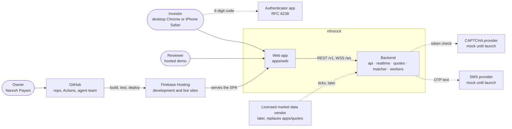

| Actor or system | Interaction |
|---|---|
| Investor | Uses the SPA. Desktop is primary; the instrument page, Trade from Charts and the scalper are phone-first (360 to 414 px) |
| Reviewer | Opens the hosted demo (`?demo=1`, login 9000000001, OTP 123456). The whole backend runs in the browser |
| Owner | Approves specs and phases, asks for releases; agents on GitHub Actions build, review, fix and merge |
| SMS and CAPTCHA | Behind `SmsProvider` and `CaptchaVerifier` interfaces. The mocks accept only dev values and **fail closed in production**, so a real provider must be wired before launch |
| Market data vendor | Not connected (D3). `apps/quotes` is the only component it replaces; nothing else reads market data from outside Redis |
| Firebase Hosting | Serves the msw-mode build: the `dev` channel (development) and the live site (production) |

### 4.2 Containers (the running processes)

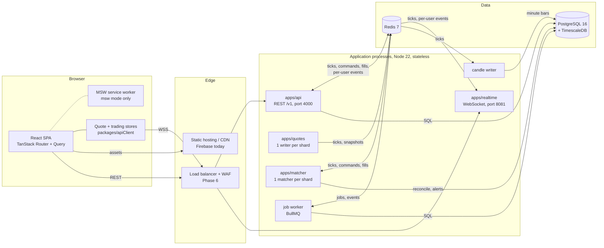

| Process | Entry | Responsibility | State it holds | Scales by |
|---|---|---|---|---|
| `apps/web` | `src/main.tsx` | Every screen; live quote and trading stores; the MSW mock in msw mode | Per tab: query cache, stores; msw mode: the paper account in sessionStorage | CDN |
| `apps/api` | `src/server.ts` | REST `/v1`: auth, users, watchlists, orders, trailing stops, portfolio, funds, market, alerts, notifications, audit, OpenAPI; commits matcher fills; publishes per-user events | Engines as a cache of Postgres; nothing that cannot be reloaded | More processes behind the load balancer (stateless) |
| `apps/realtime` | `src/server.ts` | Authenticated WebSocket fan-out: conflated binary quote frames, per-user order updates, account deltas, notifications; closes revoked sessions | Connections and subscriptions only | More nodes; each reads the same streams and subscribes only its users' channels |
| `apps/quotes` | `src/server.ts` | The one tick source per shard: GBM ticks, appended to the shard stream with a snapshot hash | The shard's last prices (rebuildable) | `SHARDS` processes, one active per shard by lease, plus standbys |
| `apps/matcher` | `src/server.ts` | Price-indexed books per instrument: crossings, trailing-stop triggers, price alerts; writes fill requests; reconciles with Postgres every 60 s | Books (rebuilt from Postgres on start) | One active per shard by lease, plus standbys |
| Job worker | `apps/api/src/worker.ts` | BullMQ schedules in IST: AMO release, square-off, day close, P&L snapshot, partitions, token cleanup, account purge | None | Several workers; BullMQ hands each run to one |
| Candle writer | `apps/api/src/candleWriter.ts` | Folds ticks into 1-minute bars and upserts them to TimescaleDB | Forming bars (re-read on restart) | One per deployment (fixed consumer name) |
| PostgreSQL 16 + TimescaleDB | Compose / CI service | Users, sessions, consents, watchlists, paper accounts, orders (partitioned), ledger, positions, holdings, trailing stops, alerts, notifications, audit log, candles | The record | Read replicas and PgBouncer; partitions; Citus by `user_id` only if needed |
| Redis 7 | Compose / CI service | Tick streams and snapshots, matcher commands and fills, per-user pub/sub, leases, OTP challenges, revocations, rate-limit counters, BullMQ queues | Short-lived or rebuildable | Redis Cluster (keys are already per shard or per user) |

### 4.3 Runtime modes and switches

The same code runs in five useful configurations. Every switch is parsed and cross-checked at
start-up (`apps/api/src/config.ts`, `apps/web/src/app/config/runtimeConfig.ts`); an inconsistent
combination refuses to start rather than half-working.

| Switch | Values (default first) | What it changes |
|---|---|---|
| `VITE_API_MODE` (web, build time) | `msw` · `api` | `msw`: the mock backend runs in a service worker and the build contains MSW; `api`: the MSW chunk is removed from the bundle entirely and the SPA calls `/v1` and `/ws` |
| `DB_DRIVER` (api) | `memory` · `postgres` | Repos in process (unit tests) or Postgres + Redis (`dev:api`, E2E, perf). `postgres` requires `DATABASE_URL` and `REDIS_URL` |
| `QUOTE_SHARDS` (api, realtime) | unset · 1 to 64 | Unset: the API's adapter ticks in process and its tick pump publishes on pub/sub. Set: prices come only from `apps/quotes` streams; `GET /v1/market/quotes` reads the snapshot hashes |
| `MATCHER_MODE` (api) | `inline` · `worker` | `inline`: the API desk follows ticks and matches in process, with a 15 s sweep. `worker` (needs `QUOTE_SHARDS`): the API follows no ticks, reads the live quote only when an action needs a price, and fills only from the matcher's requests |
| `JOBS_MODE` (api) | `inline` · `bullmq` · `off` | `inline`: the 15 s in-process sweep runs session events; `bullmq` (needs `postgres`): the job worker runs them; `off`: neither (tests). The API warns at start if `MATCHER_MODE=worker` without `bullmq` |
| `MOCK_MARKET_ALWAYS_OPEN` | false · true | Lets the mock market tick and match outside NSE hours, for demos |
| `ENABLE_TEST_CONTROLS` | false · true | Registers `/v1/__test` clock and price routes; refused unless `NODE_ENV=test`, and the web build drops them unless `VITE_TEST_CONTROLS` |

| Configuration | Used by | Web | API | Prices | Matching | Session events |
|---|---|---|---|---|---|---|
| Hosted demo | Reviewers, the live and dev sites | msw | none | In-browser adapter | In-browser engine | In-browser engine |
| Unit tests | `npm run check` | jsdom | `buildApp` + `app.inject`, memory | In-process adapter or pinned | Inline | Manual clock |
| Local full stack | `npm run dev:api` | api | postgres, `QUOTE_SHARDS=1`, `JOBS_MODE=bullmq` | `apps/quotes` | Inline (default) | Job worker |
| Wave 3 topology | `MATCHER_MODE=worker npm run dev:api` plus the matcher and candle writer | api | postgres, worker mode | `apps/quotes` | `apps/matcher` → API commits | Job worker |
| E2E api mode | CI `e2e-api` job | api | postgres, test controls | Scripted ticks | Inline | Test clock |

### 4.4 Shared packages and dependency rules

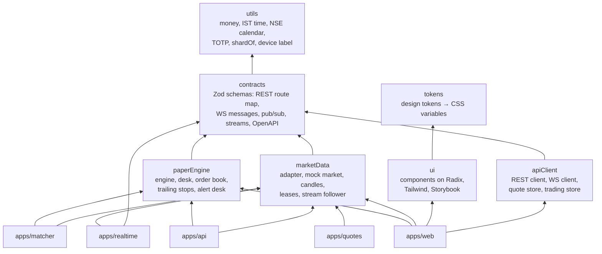

- Every package exposes only `src/index.ts`, ships ESM with types, and has no React or Node-only API
  unless it is `ui` (React) or uses Web Crypto and `fetch`, which both runtimes have. That keeps them
  usable by the React Native app later (D10).
- `paperEngine` does not import `marketData`: the desk declares the slice of the adapter it reads
  (`DeskMarket`), so the engine stays testable with a hand-written price source.
- Web imports go `routes → features → shared → packages`; a feature is imported only through its
  `index.ts` and features never import each other's internals. ESLint and
  `apps/web/scripts/checkFeatureCycles.mjs` enforce both.

### 4.5 Frontend (`apps/web`)

**Stack:** React 19, TypeScript strict, Vite, TanStack Router (file routes, typed search params,
loaders), TanStack Query (server state), Zustand (shell UI state), React Hook Form + Zod (forms),
TanStack Virtual (long lists), TradingView Lightweight Charts 5 (lazy), Tailwind CSS 4 on design
tokens, Radix primitives in `packages/ui`, MSW 3 (mock mode). ADR 0005 is the UI architecture; ADR
0012 amends it for trading state.

**Layers:**

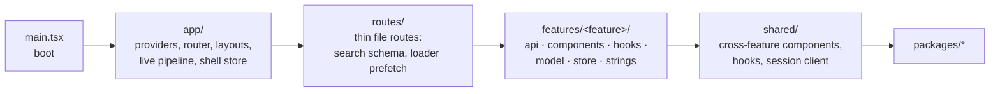

**Boot sequence (`src/main.tsx`):**

1. Parse the runtime config; an invalid `VITE_API_MODE` or URL fails fast.
2. In msw mode only, start the mock worker beside the first render (the shell and header do not
   wait). REST requests wait on its promise and call `ensureActive` first, because Chrome can stop
   an idle service worker; after a hard reload the page reloads once so the worker controls it.
   `?demo=1` is read and removed here, before the router starts.
3. Create the query client, the session-aware REST client (sends the CSRF token, refreshes once on
   a 401), and the router with `{ queryClient, apiClient }` as loader context.
4. Create the live pipeline: one WebSocket client, the quote store and the trading store
   (`app/live/liveQuotes.ts`), bind the trading store to the session, and start visibility sync.
5. Render `AppProviders` and the router.

**Routes:**

| Path | Guard | Feature page | Loader prefetch |
|---|---|---|---|
| `/` | none | redirects to `/dashboard` | |
| `/login` | none (`?deleted=` skips the session check) | `auth/LoginPage` (lazy) | |
| `/dashboard` | public | `dashboard` | indices, lists, movers, watchlists when signed in |
| `/stocks/$symbol` | public; upper-cases the symbol | `stockDetail` with `chartTrading`, `orderTicket`, `scalper`, depth, alerts | instrument first; quote, stats, candles in parallel; `range`, `interval`, `exchange`, `chart` in the URL |
| `/portfolio`, `/positions`, `/orders`, `/funds` | `_authed`: session or `/login?redirect=` | `holdings`, `positions`, `orders`, `funds` | the page's query |
| `/settings/security` | `_authed` | `security`: PIN, TOTP, recovery codes, active sessions, account deletion | |
| `/guide` | public | `guide`: the multi-tab documentation | |
| `/dev/prices` | public | live price test page used by the latency and E2E suites | |

Every route has an error boundary and a skeleton (`routeDefaults`); heavy pages split their loader,
component and not-found component into one lazy chunk.

**Feature catalogue:**

| Feature | What the user gets | Key parts |
|---|---|---|
| `auth` | OTP login, PIN set and PIN login on a trusted browser, TOTP challenge, step-up dialog, profile menu, Try demo | `LoginPage`, `RequireSession`, `StepUpDialog`, `useStepUp` |
| `dashboard` | Indices row, index chart, lists, movers, watchlist rail | `DashboardPage`, `prefetchDashboard` |
| `marketTicker` | Header index tickers and the NSE session pill | `HeaderTickers`, `MarketStatusPill` |
| `indices`, `movers`, `collections` | Index levels, top gainers and losers by index, curated lists | queries on `/v1/market/*` |
| `search` | Instrument search with popular picks and keyboard navigation | `SearchBox` |
| `watchlist` | Several watchlists, add from anywhere, reorder (drag and keyboard), sort | `WatchlistSection`, `WatchlistStar` |
| `stockDetail` | Instrument page: live price, stats, profile, depth, chart, actions | `StockDetailPage`, `MarketDepthCard` |
| `charts` | Area and candle charts, ranges 1D to 5Y, bar sizes 1m to 1w, live last bar | `PriceChart`, `candlesQuery` |
| `chartTrading` | Trade from Charts: order, position and stop lines; place from the price gutter; drag to modify; cancel | `ChartTrading`, `ChartOverlay` |
| `orderTicket` | Buy/sell ticket with review, estimate, depth, attached trailing stop; trailing stop sheet; position editor (stop terms, exit, add, open orders, NSTOCK-0395) | `OrderTicketHost`, `TrailingStopSheetHost`, `PositionEditorHost` |
| `scalper` | One-tap pad, armed by a switch, hold-to-confirm buttons | `ScalperPad`, `HoldButton` |
| `orders`, `positions`, `holdings`, `funds` | Order book and history, live P&L positions, holdings, funds and ledger, reset | pages plus `OrderUpdatesBridge`, `useLivePositions`, `useLiveHoldings` |
| `notifications` | Bell, toasts, price alerts with lines on the chart | `NotificationBell`, `NotificationsBridge`, `PriceAlertButton`, `AlertLines` |
| `security` | Settings, Security page | `SecurityPage` |
| `guide` | `/guide` documentation with diagrams | `GuidePage`, `strings.ts`, `diagrams.ts` |

**State, by kind:**

| State | Where | Why |
|---|---|---|
| Server state (lists, history, profile) | TanStack Query; `staleTime` 30 s, no refetch on focus | Caching, dedupe, loader prefetch; live data comes over the socket |
| Live prices | Quote store (`packages/apiClient/src/quoteStore.ts`) outside React | 100 ticks in a frame cost one render of each changed cell |
| Orders, positions, stops, funds, focused depth | Trading store (`tradingStore.ts`, ADR 0012) | One commit per frame for every surface; sequence-checked |
| Shell UI (rail, dialogs) | Zustand (`app/store/shellStore.ts`) | Small, synchronous UI state |
| URL state (range, interval, tab, filters) | Router search params, Zod-validated | Shareable links; invalid values are dropped, not fatal |
| Session | `shared/lib/sessionStore` + cookies | The SPA never reads a token; cookies are httpOnly |

**Performance design:** route-level code splitting; lazy Lightweight Charts and `qrcode`; self-hosted
subset fonts under 100 KB; virtualised lists; skeletons sized to the content (CLS); ticks bypass
React; the build fails above the 200 KB gzipped initial JS budget. `z.config({ jitless: true })`
keeps Zod inside a `script-src 'self'` CSP.

**Design system:** `packages/tokens` generates CSS variables (single light theme, palette with
primary `#1463D8`, contrast checked in tests); `packages/ui` builds components on Radix with
`class-variance-authority`; Storybook is the design source and its CI job runs axe on every story
(a deliberately low-contrast canary story must fail). A lint rule bans raw hex colours in the app.

### 4.6 Live data in the browser

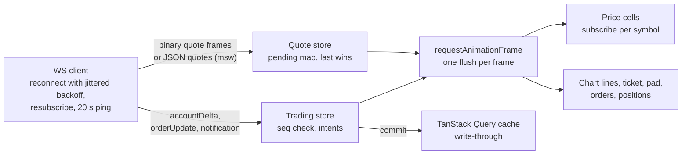

- **WebSocket client** (`wsClient.ts`): opens on the first subscription, reconnects with equal-jitter
  exponential backoff (500 ms to 30 s) so a crowd dropped at 09:15 does not reconnect in lockstep,
  resends every subscription after a reconnect, and pings every 20 s. A 4401 close refreshes the
  session once, then reconnects. Quotes arrive as 24-byte binary records from `apps/realtime` or as
  JSON from MSW; listeners see the same `Quote[]`.
- **Quote store:** ticks land in a pending map; one animation-frame flush commits them and notifies
  only the listeners of symbols that changed.
- **Trading store** (ADR 0012, SPEC-TFC-1 §10.1): loads `GET /v1/account/state`, then applies each
  `accountDelta` frame in one commit on the same frame as that frame's quotes, so no surface shows a
  fill another has not. Every engine change has a `seq`: a frame older than the store is stale; a
  newer frame that does not carry its own newest change, or a socket that reopened, means frames
  were lost, so the store re-reads the state, holds frames meanwhile and applies the newer ones on
  top. **Pending intents** (place, modify, cancel, close) show as "Updating…" until a response or a
  frame covers them; after 5 s with neither the store drops the intent, re-reads, and tells the user.
- **Visibility sync** (`visibilitySync.ts`): a background tab keeps only the active watchlist live;
  focus and reconnects take a REST snapshot to catch up.
- **Focus:** the instrument page sends `{ type: 'focus', symbol }`, which switches the connection to
  account frames with that instrument's depth and, in the mock market, ticks it every 250 ms.

### 4.7 Mock mode (MSW) and demo mode

The hosted site is the msw-mode build, so a reviewer gets the full product with no server.

- `apps/web/src/mocks/browser.ts` starts MSW with handlers for **every** route in the contracts map
  (`routeParity.test.ts` fails on a missing one) and a mock WebSocket. Handlers run the same
  `MockMarketDataAdapter` and `PaperDesk` as the API, so prices, fills and refusals match; the paper
  account is kept per tab in sessionStorage.
- `mocks/workerKeeper.ts` and `workerControl.ts` keep the worker in control when Chrome restarts it
  after idling, and reload once after a hard reload.
- **Demo mode** (`nthstock.demoMode` in sessionStorage, or `?demo=1` at load) seeds the demo account
  (watchlists, holdings, ledger from `paperEngine/demoSeed`) and registers the Demo simulator, whose
  Rally, Pull back and Gap buttons move one instrument's real feed, so every screen and every
  trailing stop sees the same move. **Try demo** on `/login` gives the same from a cold load and
  opens RELIANCE.
- In api mode the MSW chunk is absent (`checkBuild.mjs` verifies), and Try demo only logs in.
- The walkthrough video is recorded by Playwright on a 390 px touch phone against the production
  build (`docs/runbooks/demo-walkthrough.md`).

### 4.8 API (`apps/api`)

**Request pipeline.** Fastify 5, one process, hooks in this order:

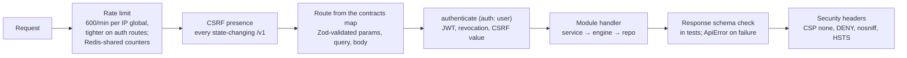

- **Errors:** every failure is an `ApiError` envelope (`code`, `message`, optional `details`) from
  one error handler (`http/errorHandler.ts`); a 429 becomes `RATE_LIMITED`; a database error's row
  detail is dropped before logging.
- **Route registration:** `http/registerRoute.ts` takes a route key from the contracts map, so method,
  path, schemas and auth cannot drift from the client.
- **Lifecycle hooks (`app.ts`):** on ready, load every account with a resting order (so it fills on
  the first crossing tick after a restart), reload active price alerts, wait up to 5 s for the quote
  snapshots, start the order-update and notification publishers (with the outbox relay), and start
  the 15 s order sweep only in `inline` mode. On close, dispose the desk, timers, pools and Redis
  clients.

**Modules** (`apps/api/src/modules/<module>/`):

| Module | Owns | Routes | Storage |
|---|---|---|---|
| `health` | Liveness and readiness (Postgres ping, Redis ping) | `GET /v1/health`, `/v1/health/ready` | |
| `auth` | OTP, PIN, sessions, refresh rotation, TOTP, step-up, active sessions, account deletion, CAPTCHA, SMS, rate limits | 18 routes under `/v1/auth/*` and `/v1/account/deletion` | `devices`, `device_tokens`, `pins`, `sessions`, `refresh_tokens`, `totp_*`; Redis OTP challenges and revocations |
| `users` | Users, consent records, the demo user, PII crypto | (used by auth) | `users`, `consents` |
| `watchlists` | Watchlists and items, ordering | 8 routes under `/v1/watchlists` | `watchlists`, `watchlist_items` |
| `market` | Indices, lists, movers, quotes, search, instrument, candles, depth, profile, stats | 11 public routes under `/v1/market` | Adapter in memory; snapshots in Redis; candles in TimescaleDB |
| `orders` | Order service on the paper desk, account store, matcher commands and fills, order and delta publisher, trailing stops, position close, account state | `/v1/orders*`, `/v1/trailing-stops*`, `/v1/positions/close`, `/v1/account/state` | `paper_accounts`, `orders`, `order_events`, `ledger_entries`, `positions`, `holdings`, `holding_sales`, `trailing_stops` |
| `portfolio` | Positions, holdings, summary, P&L snapshots | `/v1/positions`, `/v1/holdings`, `/v1/portfolio/summary` | reads the account; `pnl_snapshots` |
| `funds` | Funds summary, paged ledger, account reset | `/v1/funds`, `/v1/funds/ledger`, `/v1/funds/reset` | `ledger_entries` (append-only) |
| `alerts` | Price alerts: create, cancel, watch, fire once | `/v1/alerts`, `/v1/alerts/:id` | `price_alerts` |
| `notifications` | Notification centre, outbox, publisher, security notices | `/v1/notifications`, `/v1/notifications/read` | `notifications`, `notification_outbox` |
| `audit` | Append-only audit log with a detail deny-list | (written by every module) | `audit_log` (trigger rejects UPDATE and DELETE) |
| `candles` | Candle store, minute aggregator, writer, seed, reader | (backs the market candles route) | `candles_1m` + continuous aggregates |
| `jobs` | Scheduled job definitions, runner, BullMQ scheduler | (worker entry) | BullMQ in Redis |
| `demo` | Demo seed on Postgres (`DEMO_SEED=true`) | | through the repos |
| `docs` | OpenAPI document | `GET /v1/docs/openapi.json` | generated |
| `testControls` | E2E clock and price controls (test only) | `/v1/__test/*` | |

**Module anatomy:** `index.ts` (the only import surface), `routes.ts`, `service.ts` (rules; calls the
engine), `repo.ts` (interface + in-memory driver), `pgRepo.ts` (Drizzle on Postgres), `schema.ts`,
with tests beside them. `deps.ts` wires each module's repo to the memory or Postgres driver by
`DB_DRIVER`, so the same service tests run against both (ADR 0004 §3, ADR 0007).

**Dependency injection:** `createDeps` builds the clock, repos, market adapter, SMS, CAPTCHA, JWT key,
Argon2id hasher, order service, alert service, notifier, quote streams, matcher commands and fills,
and the candle store. Tests override any part; the app disposes only what it created.

### 4.9 Contracts, OpenAPI and contract tests

- **Route map** (`packages/contracts/src/routes.ts`): 60+ routes, each `{ method, path, auth,
  params?, query?, body?, response }`. The REST client (`createApiClient`) is typed from it, the API
  registers from it, MSW handlers are keyed by it.
- **WebSocket protocol** (`ws.ts`, version 1): client `subscribe`, `unsubscribe` (max 200 symbols),
  `ping`, `focus`; server `instruments`, `quotes`, `orderUpdate`, `accountDelta`, `notification`,
  `pong`, `error`. Close codes 4401 (unauthorised or revoked) and 4408 (idle 60 s).
- **Binary quote frame** (`quoteFrame.ts`): 12-byte header (magic `0x51`, version, count, base time)
  and 24-byte records (token, LTP, high, low, volume as u32; change in basis points as i16; age as
  u16), little-endian; symbol, exchange, open and previous close come once per token in an
  `instruments` message. A value that does not fit falls back to a JSON `quotes` message.
- **Server-to-server messages** (`pubsub.ts`, `matcherCommands.ts`): tick batches and stream entries,
  order updates, account deltas, notifications, session revocations, matcher commands and fills,
  each versioned and validated on read.
- **OpenAPI 3.1** is generated from the route map with Zod 4's `z.toJSONSchema()`, served at
  `GET /v1/docs/openapi.json` (ETag, 304 on revalidation) and committed as `docs/api/openapi.json`;
  CI fails when the committed copy is stale.
- **Contract tests:** `apps/api/src/test/contract.test.ts` checks every route is registered with the
  same method, path and auth, and nothing under `/v1` exists outside the map; `contractChecked()`
  wraps every scenario backend (Fastify inject, API on Postgres + Redis, MSW in Node) and parses
  every response with its schema; the scenario suite (`packages/contracts/src/testing/scenarios`)
  runs the same journeys against both backends.

### 4.10 Market data (`packages/marketData`)

- **Adapter** (`adapter.ts`): `MarketDataAdapter` exposes instruments, quotes, subscriptions,
  candles, depth, lists, movers, search, profile and stats. `MockMarketDataAdapter` implements it;
  a vendor adapter would too. Contract tests (`contractTests.ts`) hold any implementation to it.
- **Symbol master** (`symbolMaster.ts`): about 5,000 equities plus the major indices from a fixed
  seed (20260925); real large caps keep their names; faker generates the rest.
- **Ticks** (`ticks.ts`): geometric Brownian motion per instrument,
  `next = price × exp((μ − σ²/2)·Δt + σ·√Δt·z)`, with sector drift and volatility, each instrument on
  its own seeded random stream; rounded to the 5-paise tick and clamped to the ±20% circuit band.
  The focused instrument ticks every 250 ms, the rest every second, only while subscribed. After a
  paused tab, instruments with working orders replay missed ticks in order (up to 30 minutes).
- **Candles** (`candles.ts`, `candleHistory.ts`, `minuteBars.ts`): each range's own bars (1D 1-minute,
  1W 5-minute, 1M hourly, 1Y daily, 5Y weekly); `resampleCandles` groups to `1m|5m|15m|30m|1h|1d|1w`
  (allowed pairs in `CANDLE_INTERVALS`); intraday bars start at 09:15 IST. In the browser
  `useLiveCandles` folds each quote into the last bar of whatever range and bar size is on screen,
  on the instrument page and the dashboard NIFTY 50 chart alike, and starts the next bar when its
  interval begins (NSTOCK-0441). The hosted demo is forced open at any hour, so bars keep the same
  grid outside 09:00 to 15:30 instead of piling into the 09:15 bar. The dashboard NIFTY 50 chart
  shares the instrument page's chart type menu and bar size picker (`ChartTypeMenu` in
  `features/charts`), keeps both in the dashboard URL (`?interval=&chart=`) and opens as a line of
  1-minute bars on 1D (NSTOCK-0443).
- **Index ETFs** (`symbolMaster.ts`, `INDEX_ETFS` in `packages/contracts`, NSTOCK-0440): an index
  cannot be traded, so each major index has a mock tracking ETF (NIFTYETF, SENSEXETF, BANKETF,
  ITETF, MIDCAPETF; tokens from 950001) priced at a hundredth of the index level on every tick, with
  the index's candles scaled the same way. They trade like any equity but stay out of lists and
  movers; an index page shows a Buy/Sell ETF card (a bottom bar on a phone) that opens the fund's
  order ticket.
- **Depth, lists, index levels** (`depth.ts`, `lists.ts`, `indexLevels.ts`): five levels of depth;
  index levels computed from constituents.
- **Distributed helpers:** `startLease` (`shardLease.ts`) and `followTickStreams`
  (`tickStreamFollower.ts`) are shared by the quote service, the API, realtime and the matcher.

### 4.11 Quote service (`apps/quotes`) and the tick streams

The quote service is the single source of prices, so every API process, realtime node, matcher and
the candle writer see the same tick. It depends on nothing but Redis because it is what a licensed
feed replaces.

- **Shards:** an instrument's shard is `shardOf(token, SHARDS)` (FNV-1a, `packages/utils`). Locally
  `SHARDS=1`.
- **One writer per shard:** a process writes only while it holds `lease:quotes:{shard}`
  (`SET … NX PX 5000`, renewed every 2 s; renew interval must be at most half the TTL). A standby
  takes over when the holder stops, or within the TTL when it dies.
- **Stream and snapshot:** each batch is one `XADD nthstock:ticks:v1:{shard} MAXLEN ~ 2400` entry
  (about 10 minutes at 4 a second) with a per-shard `seq`, and its quotes go to the snapshot hash
  `nthstock:quotes:last:v1:{shard}` in the same `MULTI`.
- **Consumers:** each reads the snapshot at start, then follows with blocking `XREAD`. Any `seq`
  other than last + 1 (a restarted writer starts again at 1, or a trimmed stream) triggers a
  snapshot re-read (`tickStreamStep`); a malformed entry is logged and skipped. A failed write is
  dropped (the next tick supersedes it) and logged once until writing recovers.

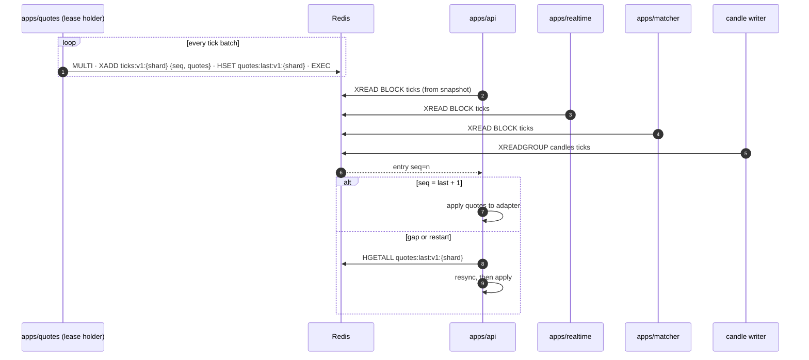

Without `QUOTE_SHARDS` the API's adapter ticks in process and its tick pump publishes each batch on
the pub/sub channel `nthstock:ticks:v1`, which `apps/realtime` reads instead (unit tests, older
set-ups).

### 4.12 Realtime gateway (`apps/realtime`)

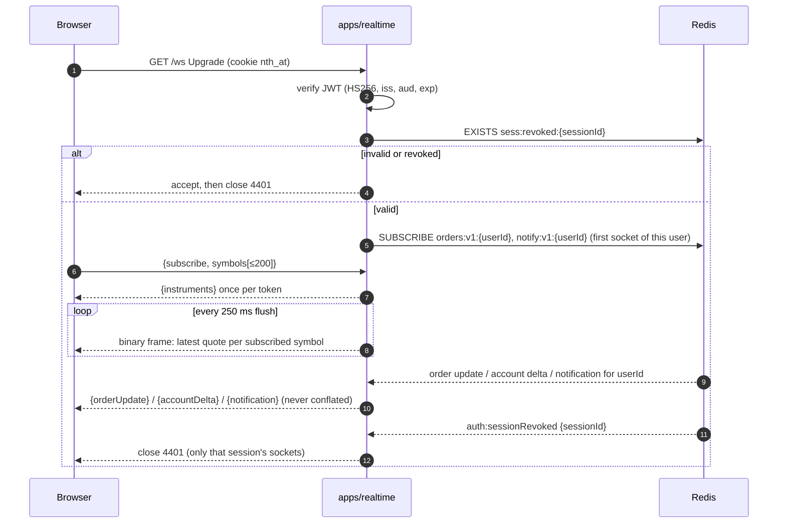

- **Authentication:** every upgrade is checked against the `nth_at` cookie with the shared
  `JWT_SECRET`. A bad token is accepted and closed with 4401 so the browser sees why (a refused
  upgrade shows only as 1006).
- **Subscriptions:** a registry maps `exchange:symbol` to connections, up to 200 per connection
  (more is refused with `SUBSCRIPTION_LIMIT`); a malformed or unsupported message gets an `error`
  frame and the connection stays open.
- **Conflation:** per connection, the latest quote per key since the last flush (last value wins),
  flushed every 250 ms, so at most 4 updates a second per symbol, in one binary frame.
- **Private channels:** a node subscribes a user's order and notify channels only while it holds a
  connection for that user, and checks each event's `userId` against its channel and contract
  before delivering. Order updates, account deltas and notifications are never conflated or dropped.
- **Backpressure:** above 1 MB buffered for a client, its quote frames are dropped (counted in
  `droppedFrames`); private messages still go.
- **Heartbeat:** every 5 s idle checks, a protocol ping every 20 s, close 4408 after 60 s of silence.
- **Revocation:** `auth:sessionRevoked` closes that session's sockets with 4401 and leaves the user's
  other sessions open.

### 4.13 Paper engine (`packages/paperEngine`)

The engine is one user's account: orders, positions, holdings, funds ledger and trailing stops.
It is pure and deterministic: time only from `ctx.now()`, prices only from `ctx.ltp()`, instruments
from an injected source. The browser mock, the API and the matcher run it unchanged.

**Order lifecycle** (`orderStateMachine.ts`):

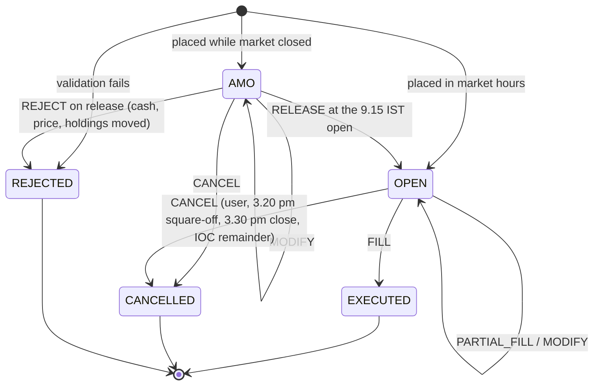

**Rules:**

- **Validation** (`orderValidation.ts`): a known instrument, a positive quantity, a price on the
  5-paise tick and inside today's circuit band, intraday only in market hours up to the 15:20
  square-off, enough holdings for a delivery SELL, enough cash for a BUY (blocked on placement). A failed new order is stored as
  REJECTED with a plain-language reason.
- **Fills:** a MARKET order fills at the LTP; a marketable LIMIT at the better of its limit and the
  LTP; a resting LIMIT when the price crosses it, in parts under a per-tick cap (SPEC-TFC-1 §10.3),
  with a volume-weighted `avgFillPrice` and each part releasing its share of blocked cash. IOC
  cancels what did not fill.
- **Session events on IST trading days** (holidays from `packages/utils/src/nseHolidays2026.ts`):
  09:15 release AMOs; 15:20 square off intraday positions and cancel live intraday orders; 15:30
  cancel open day orders and move delivery buys into holdings.
- **Funds ledger** (`fundsLedger.ts`): append-only signed entries (`OPENING_CREDIT`, `ORDER_BLOCK`,
  `ORDER_RELEASE`, `TRADE_DEBIT`, `TRADE_CREDIT`, `RESET`), each with the available cash after it, in
  integer paise.
- **`seq`:** rises by one with every order or trailing-stop change; each changed record carries it,
  which is what the trading store and `accountDelta` frames order by (ADR 0012).
- **`PaperDesk`:** one engine per user fed by one market. Accounts are separate by construction and
  one user's work never waits on another's. `ingestFor` runs one user's engine at a given tick (the
  matcher's fills).
- **`OrderBook`** (`orderBook.ts`, NSTOCK-0363): per instrument, BUY and SELL limits in price heaps
  and trailing stops in heaps on stop, watermark and activation prices, plus price alerts in two
  heaps; a tick pops only what it fills, triggers, ratchets, activates or fires. Property-tested
  against a full walk. A change applies only when its version is newer than the one held.

**Trailing stop lifecycle** (`trailingStop.ts`, SPEC-TFC-1 §6):

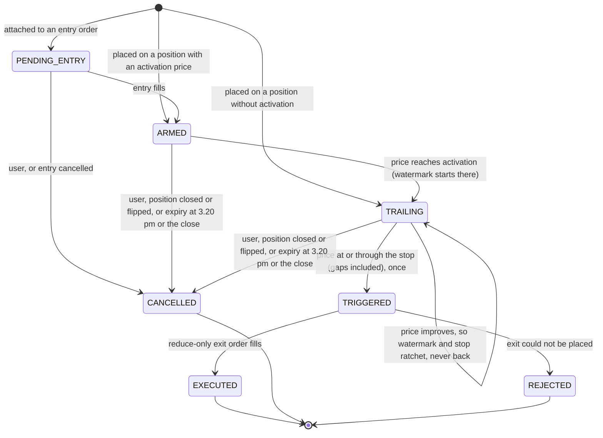

The trail is a rupee amount or a percentage (integer basis-point arithmetic, so no float can move a
stop by a tick); a long floors the stop below the watermark, a short ceils it above. Dragging the
stop line becomes a rupee trail measured from the watermark at the moment it applies. The ticket,
the chart and the engine call the same `validateTrailingStop` and `previewTrailingStop`, so they
never disagree.

### 4.14 Paper accounts on PostgreSQL

Spec `backend-core.md` §5.3, ADR 0007. The `AccountStore` (`modules/orders/accountStore.ts`; memory in
`repo.ts`, Postgres in `pgRepo.ts`) is the record of each account; the per-user `PaperEngine` on the
desk is a cache of it.

- **Load:** the first use of an account loads its **working set** (live orders, today's orders,
  positions, holdings, today's trailing stops and active ones, today's ledger with earlier entries
  carried as a balance, the engine `seq`) and its **version**.
- **Commit:** every engine change is committed with its audit entries and notifications in one
  transaction against the version it was read at (`UPDATE paper_accounts … WHERE version = $n`).
  A commit that loses reloads the account and runs the action once more; losing twice answers
  409 `CONFLICT`. Any other failure answers 500 and the account is reloaded before its next use.
- **Per-user queue:** each user's commits run in order on their own promise chain; users never wait
  for each other.
- **Reads:** order book, history and ledger pages read from the store, so they cover every day.
- **Restart:** at boot, and on the sweep if the database was down then, the API loads every account
  with an AMO or OPEN order.
- **After commit:** listeners publish the order updates and the account delta on the user's channel,
  send matcher commands for changed LIMIT orders and stops, and hand stored notifications to the
  publisher.
- **Reset and demo seed:** a reset clears stored orders and history (the ledger is append-only and
  keeps every row); the demo seed replaces the whole account.

### 4.15 Matcher (`apps/matcher`)

Spec `market-data-and-matching.md` §5, ADR 0013. The matcher finds what a tick fills; `apps/api`
commits it. That keeps one writer per account (the account store) while matching scales per shard.

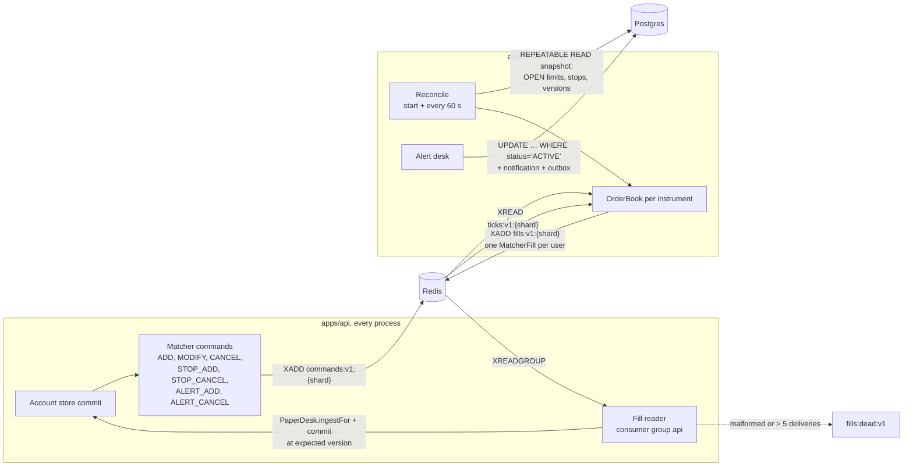

- **Lease and standbys:** one process per shard holds `lease:matcher:{shard}`; every process for the
  shard keeps following the tick stream, so a standby is current when it takes over. Only the holder
  acts, and only in market hours (or `MOCK_MARKET_ALWAYS_OPEN`).
- **Commands:** after each commit the API appends commands to `nthstock:matcher:commands:v1:{shard}`
  (capped at 1,00,000 entries) stamped with the account version; every matcher process applies them
  by the version rule, so a late or replayed command never undoes a newer one.
- **Reconcile** (NSTOCK-0366, 0387): on start and every 60 s, one REPEATABLE READ snapshot of the
  shard's OPEN LIMIT orders (partial index `orders_shard_live_idx` on `orders.shard`, migration 0016),
  ARMED and TRAILING stops and account versions; upsert what is live and remove what is not, at the
  account version, and put back a stop a tick triggered whose fill never committed. Reads are bounded
  by connection and query timeouts so a stalled Postgres cannot wedge it.
- **Fills** (NSTOCK-0367, 0388): for each tick that crosses an order or triggers a stop, the holder
  writes one `MatcherFill` per user to `nthstock:matcher:fills:v1:{shard}`. Every API process reads
  all fill streams in the `api` consumer group, runs the user's engine at the tick's price and time,
  commits with the expected version, publishes, then `XACK`s. The engine re-checks every order, so a
  replay fills nothing twice. An unacked request is claimed by another process after 30 s
  (`XAUTOCLAIM`); a version conflict retries up to 3 times; a malformed request or one delivered more
  than 5 times goes to `nthstock:matcher:fills:dead:v1` with its reason and is acked, and the next
  reconcile puts its order back on the book.
- **Price alerts:** active alerts sit on the books in two heaps (ABOVE lowest first, BELOW highest
  first), reloaded every 60 s; a firing is one conditional UPDATE plus its notification and outbox
  row, so it fires exactly once whoever sees the tick first.
- **Running it:** `npm run dev -w @nthstock/matcher` with `REDIS_URL`, `DATABASE_URL` (the
  `nthstock_app` role), `SHARD`, `SHARDS`, beside `MATCHER_MODE=worker npm run dev:api`. `dev:api`
  does not start it, so the default local stack keeps inline matching.

### 4.16 Trailing stops on the server

In api mode trailing stops run on the server with the same engine rules as the browser mock.

- **Store:** working set version 4 carries the stops, the engine `seq`, exit order ids and idempotency
  keys. Migration 0015 adds `trailing_stops` (trail as unit plus amount or basis points, CHECKed
  against the contract lists) and `paper_accounts.seq` and `exit_order_ids`.
- **Routes:** `GET/POST /v1/trailing-stops`, `PATCH/DELETE /v1/trailing-stops/:id`,
  `POST /v1/positions/close`, `GET /v1/account/state`. Every action is audited
  (`TRAILING_STOP_PLACE`, `_MODIFY`, `_CANCEL`, `POSITION_CLOSE`, `TRAILING_STOP_UPDATE`).
- **Frames:** after each commit the orders module publishes an `AccountDeltaEvent` (changed orders and
  stops at their newest `seq`, positions, funds) on the user's channel after the order updates;
  `apps/realtime` forwards it as an `accountDelta` frame.
- **Matching:** `inline` steps stops in the API's desk on its ticks; `worker` leaves stepping and
  triggering to the matcher's books, which receive `STOP_ADD` / `STOP_CANCEL` after every change.

### 4.17 Candle store (TimescaleDB)

Spec `market-data-and-matching.md` §7. Chart bars are stored, so the 1-minute bar a user watched form
is the bar the chart shows after a reload.

- **Database:** `timescale/timescaledb:2.17.2-pg16` in Compose, CI and Testcontainers. Migration
  `0014_timescaledb_candles` creates the extension as `nthstock_owner`; `nthstock_app` may read and
  upsert bars, never delete them or run DDL.
- **Storage:** `candles_1m (token, bucket, open, high, low, close, volume)`, prices in paise, primary
  key `(token, bucket)`, a hypertable in 1-day chunks, compressed by `token` after 7 days.
- **Aggregates:** `candles_5m`, `_15m`, `_30m`, `_1h`, `_1d` are continuous aggregates on
  `time_bucket(…, origin => 09:15 IST)`, so bars start at the NSE open and a daily bar is one session;
  real-time aggregation includes minutes not yet materialised. Weekly bars group `candles_1d`.
- **Writer:** reads every tick stream in the `candles` consumer group, keeps each instrument's
  forming bar in memory, and on a minute boundary writes every closed bar in one multi-row
  `INSERT … ON CONFLICT (token, bucket) DO UPDATE`, then acks. A restart re-reads what was not stored:
  no minute is lost and a replayed one overwrites itself with the same values.
- **Reader:** 1-minute bars from the hypertable, 5 minutes to 1 hour and daily from the aggregates,
  weekly by grouping daily, and the forming bar finished with the live price from the snapshot. A
  symbol with no stored bars in the window falls back to generated bars, so nothing regresses.
- **History:** `npm run db:seed:candles` writes 2 years of daily bars and 30 days of 1-minute bars
  from the deterministic generator (66 instruments, about 5.8 lakh rows, `--all` for every symbol).
- **Running it:** `npm run dev:candles -w @nthstock/api` beside `npm run dev:api`.
- **Planned (Phase 6):** RDS has no TimescaleDB; the spec's open question 1 chooses between
  self-managed Postgres on EC2, Timescale Cloud, or native partitions with rollup tables. The queries
  are plain `time_bucket` reads, so the fallback is contained.

### 4.18 Background jobs (BullMQ)

Spec `backend-core.md` §3 and §9, ADR 0007 §11. Code: `modules/jobs/`, entry `worker.ts`, the same
codebase as the API so jobs share repos, the engine and quote-service prices.

| Job | Cron (Asia/Kolkata) | What it does |
|---|---|---|
| `session.amoRelease` | 09:15, Mon to Fri, trading days | Syncs every account with an AMO to the open: AMOs are released and market AMOs fill |
| `session.squareOff` | 15:20, trading days | Squares off intraday positions, cancels live intraday orders, expires intraday stops |
| `session.dayClose` | 15:30, trading days | Cancels open day orders, settles delivery buys into holdings |
| `pnl.snapshot` | 15:45, trading days | One `pnl_snapshots` row per account touched today or holding stock |
| `db.orderPartitions` | 00:30 daily | Keeps 14 days of `orders` and `order_events` partitions ahead |
| `auth.tokenCleanup` | 03:00 daily | Deletes expired refresh and device tokens and sessions expired over 30 days |
| `account.purge` | 02:00 daily | Purges accounts past `purge_after`, one transaction each, as `nthstock_purge` (`PURGE_DATABASE_URL`): deletes the user's rows from every table but `audit_log`, nulls the PII columns, sets `purged_at` last and audits `ACCOUNT_PURGED` |

- Each job is a plain `run(at, deps)` function of its due time, unit-tested with a fixed clock;
  BullMQ (queue `jobs`, prefix `nthstock:bull`) only schedules and retries it (3 attempts, exponential
  backoff from 30 s). The job id (scheduler id plus due time) keeps one run per time across workers.
- **Idempotent:** a session job reloads each account, syncs it to now and commits against its
  version, so a rerun, a retry or the API committing the same event first changes nothing twice.
- **Shutdown:** SIGTERM waits for the running job, flushes audit writes and order updates, closes pools.
- **No PII in logs:** a result is counts only; a failure is job, attempt and error class.

### 4.19 Notifications and price alerts

Spec `market-data-and-matching.md` §6 (E24, NSTOCK-0379 to 0385).

- **Notifications:** a `notifications` row (kinds `PRICE_ALERT`, `ORDER_FILLED`, `ORDER_REJECTED`,
  `TRAILING_STOP`, `AMO_RELEASED`, `SQUARED_OFF`, `SECURITY`) is written **in the same transaction as
  its cause**: the account store derives them from each order change (`changeNotifications.ts`). The
  newest 100 per user are kept. Bodies never hold a mobile number or a name.
- **Transactional outbox:** each row gets a `notification_outbox` row in the same transaction. After
  commit the API publishes a `NotificationEvent` on `nthstock:notify:v1:{userId}` and deletes the
  outbox row; a relay republishes rows older than 5 s every 5 s. Delivery is at least once; the web
  app drops an id it already holds.
- **Fan-out:** `apps/realtime` pushes `{ type: 'notification' }` to that user's sockets only; the bell
  and toasts update with no poll; after a reconnect the list and alerts are re-read.
- **Price alerts:** `price_alerts` (migration 0019), at most 50 active per user. An ABOVE alert fires
  on the first price at or above its level, BELOW at or below; a gap fires with the LTP that crossed;
  a level already passed is refused. Watched by the API and by the matcher's books; whichever sees
  the tick first wins one `UPDATE … WHERE status = 'ACTIVE' RETURNING`, so it fires exactly once.
- **Security notices:** a sign-in from a new device, two-factor turned on or off, and logging out the
  other sessions raise a `SECURITY` notification with the device type and IST time ("Not you? Change
  your PIN."). Raising one never fails the action it reports.

### 4.20 Identity and access

**Factors and tokens:**

| Element | Design |
|---|---|
| OTP | 6 digits, hashed (never stored plain), 5-minute TTL, one live challenge per mobile, 30 s resend throttle, CAPTCHA after 3 wrong attempts, burnt after 5. Redis hash per mobile keyed by the mobile's blind index; failure counting and consumption are Lua scripts, so concurrent verifies count exactly. Outside production the OTP is always `123456` and the mock SMS provider logs it |
| PIN | Argon2id (`@node-rs/argon2`); valid only on a trusted browser (`nth_dev` cookie bound to a device token); lock after 5 wrong, unlock by OTP |
| TOTP | RFC 6238 on Web Crypto (`packages/utils/src/totp.ts`), 30 s step, ±1 step; secret AES-GCM encrypted per user; `last_used_step` refuses replay; 10 recovery codes stored as hashes, shown once |
| Access token | HS256 JWT (`jose`), 15 minutes, `iss`/`aud`/`exp` checked; cookie `nth_at` (Path=/, httpOnly, Secure in production, SameSite=Strict), also read by `apps/realtime`; or `Authorization: Bearer` |
| Refresh token | Opaque, 30 days, stored as SHA-256, cookie `nth_rt` (Path=`/v1/auth` only); rotates on every refresh. The session id is the token family: presenting a rotated token revokes the family (`REFRESH_REUSE_DETECTED`) |
| CSRF | Every state-changing `/v1` request must carry `X-CSRF-Token`; with a session it must equal `Session.csrfToken` (constant-time compare). No CORS is granted, so a cross-site page cannot add the header |
| Step-up | Sensitive routes (TOTP on/off, recovery codes, revoking sessions, account deletion) answer 403 `STEP_UP_REQUIRED` unless the session re-proved the user in the last 10 minutes with the PIN or a `STEP_UP` OTP (never usable as a login), plus TOTP when on. `useStepUp` opens one shared dialog and retries once |
| Revocation | Postgres `sessions.revoked_at` is the record; Redis `sess:revoked:{id}` (TTL = access token life) and `auth:sessionRevoked:v1` make it reach every API instance and realtime node at once |
| Rate limits | Global 600/min per IP; per IP per minute: OTP request 20, OTP verify 30, PIN verify 30, PIN set 10, refresh 60, TOTP verify 30, step-up 20; counters shared in Redis |
| Audit | `LOGIN_SUCCESS`, `LOGIN_FAILED` (method and code, never the mobile or OTP), `PIN_SET`, `PIN_LOCKED`, `LOGOUT`, `REFRESH_REUSE_DETECTED`, `SESSION_REVOKED`, `STEP_UP`, `TOTP_ENABLED`, `TOTP_DISABLED`, `RECOVERY_CODE_USED`, `RECOVERY_CODES_REGENERATED`, `CONSENT_GRANTED`, `ACCOUNT_DELETION_REQUESTED` |

**Active sessions:** `GET /v1/auth/sessions` lists live sessions with a device label derived from
the user agent (never the raw string) and no IP address; revoking one or all others needs a step-up
and goes through `SessionService.revoke` (marked, audited, published). The current session is
refused (400); it logs out from the profile menu.

### 4.21 Privacy, consent and account deletion (DPDP Act 2023)

- **Consent:** the first OTP login sends `consentVersion` (`CONSENT_POLICY_VERSION`). A sign-up
  without the current version answers 400 `CONSENT_REQUIRED`; the user and its `consents` row are
  written in one transaction, then `CONSENT_GRANTED` is audited.
- **PII at rest:** the mobile is AES-256-GCM encrypted with the column name as authenticated data
  (`[key id][IV][tag][ciphertext]`, rotatable keys from `PII_ENC_KEYS`) and found by an HMAC-SHA256
  blind index (`PII_HMAC_KEY`). Production refuses to start without real keys.
- **PII in motion:** events, notifications, audit details and logs carry opaque ids only; the audit
  writer refuses detail keys on a deny-list (for example anything containing `token`).
- **Deletion:** `POST /v1/account/deletion` (`{ confirm: 'DELETE' }`, step-up) marks the user deleted
  with `purge_after` = now + 30 days, revokes every session (`ACCOUNT_DELETED`, tokens and sockets end
  at once), cancels OPEN and AMO orders, audits `ACCOUNT_DELETION_REQUESTED`, and clears the cookies.
  Until the purge an OTP login answers 403 `ACCOUNT_DELETED` with `purgeAfter`, and every read hides
  the user. The purge job (T-230, `account.purge`, `apps/api/src/modules/jobs/accountPurge.ts`) then
  runs as `nthstock_purge`: it deletes the user's rows from every table in `PURGED_TABLES` (an
  integration test checks that list against the live catalog), nulls the PII columns, sets
  `purged_at` and writes `ACCOUNT_PURGED`, leaving a tombstone that audit rows still name. The mobile
  can then sign up as a new user.
- **Web:** the app navigates to `/login?deleted=<purgeAfter>` first, then clears the session, query
  cache and trusted-browser record.

### 4.22 Data architecture

**Entity relationships (PostgreSQL):**

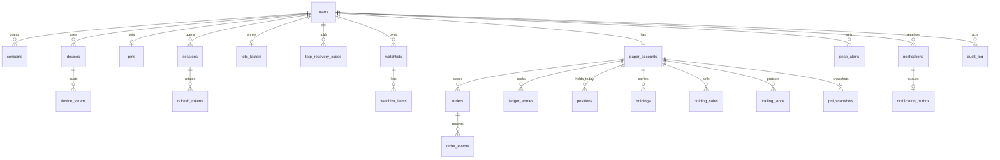

| Area | Tables | Notes |
|---|---|---|
| Identity | `users`, `consents`, `devices`, `device_tokens`, `pins`, `sessions`, `refresh_tokens`, `totp_factors`, `totp_recovery_codes` | Mobile encrypted + blind index; tokens stored as hashes |
| Watchlists | `watchlists`, `watchlist_items` | Deferrable unique positions for reordering in one statement |
| Paper trading | `paper_accounts` (version, seq, exit order ids), `orders`, `order_events`, `ledger_entries`, `positions`, `holdings`, `holding_sales`, `trailing_stops`, `pnl_snapshots` | Money as `bigint` paise with CHECKs (price on the 5-paise tick); ledger append-only |
| Orders partitioning | `orders`, `order_events` range-partitioned by IST `trade_date` with a DEFAULT partition | Hand-written migration 0011; partial indexes for live orders by user and by shard |
| Notifications | `notifications`, `notification_outbox`, `price_alerts` | Kinds CHECKed against the contract list |
| Audit | `audit_log` | Append-only: privileges revoked and a trigger rejects UPDATE and DELETE |
| Candles | `candles_1m` hypertable, `candles_5m` … `candles_1d` continuous aggregates | TimescaleDB, compressed after 7 days |

**Roles** (`infra/postgres/init.sql`): `nthstock_owner` owns the schema and runs migrations
(`DATABASE_MIGRATION_URL`); `nthstock_app` is what the API, matcher and writers connect as (DML only,
never DDL); `nthstock_purge` is the purge job (DML plus deleting a purged user's ledger rows, never
audit rows).

**Migrations:** Drizzle, `apps/api/drizzle/0000` to `0019`, plain SQL reviewed in PRs, applied by
`npm run db:migrate`. Partitioned and TimescaleDB objects are hand-written; `db:check` compares a
migrated database with the schema files plus the hand-written relations in CI.

**Redis keyspace** (namespace `nthstock:` unless stated):

| Key or channel | Type | Writer → readers | Lifetime |
|---|---|---|---|
| `ticks:v1:{shard}` | Stream | quotes → api, realtime, matcher, candle writer | `MAXLEN ~ 2400` |
| `quotes:last:v1:{shard}` | Hash token → Quote | quotes → api (`/market/quotes`), every follower on resync | Overwritten per batch |
| `lease:quotes:{shard}`, `lease:matcher:{shard}` (no namespace) | String | lease holder | `PX 5000`, renewed every 2 s |
| `matcher:commands:v1:{shard}` | Stream | api → matcher | `MAXLEN ~ 100000` |
| `matcher:fills:v1:{shard}` | Stream, group `api` | matcher → api | Acked after commit |
| `matcher:fills:dead:v1` | Stream | api | `MAXLEN ~ 10000`, for inspection |
| `orders:v1:{userId}` | Pub/sub | api, worker → realtime | Fire and forget (state is re-read on gap) |
| `notify:v1:{userId}` | Pub/sub | api, matcher → realtime | Outbox covers misses |
| `auth:sessionRevoked:v1` | Pub/sub | api → api, realtime | |
| `sess:revoked:{sessionId}` | String | api | TTL 15 minutes |
| `otp:{blindIndex}`, `otp:resend:{blindIndex}`, `otp:totp:{challengeId}` | Hash / string | api | 5 minutes / 30 s / 5 minutes |
| `rate-limit:*` | Counters | api | 1 minute windows |
| `bull:jobs:*` (prefix `nthstock:bull`) | BullMQ | worker | Per BullMQ retention |
| `ticks:v1` | Pub/sub | api tick pump → realtime | Only without `QUOTE_SHARDS` |

### 4.23 Key flows, end to end

**Login with OTP (and TOTP when on):**

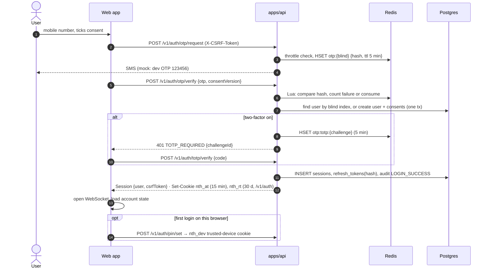

**Place an order (inline matching):**

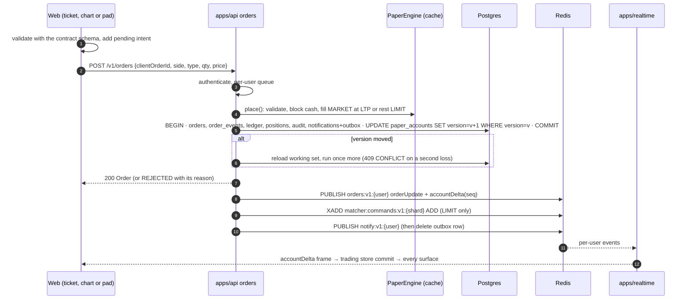

**Resting order filled by the matcher (worker mode):**

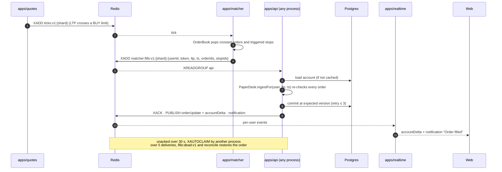

**Trailing stop triggers:** the stop's heap entry is popped when the price is at or through it; the
fill request carries the stop, the API's engine re-runs the step at that price, marks it TRIGGERED,
places one reduce-only MARKET exit, commits (with a `TRAILING_STOP` notification), and the chart's
stop line turns into a filled exit on the next frame.

**Price alert fires:**

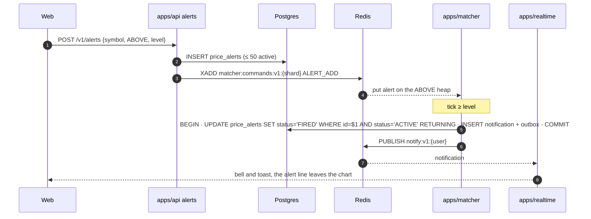

**Candle write:**

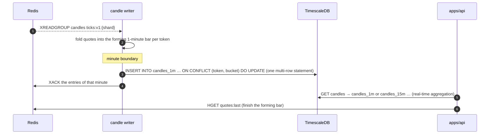

**Session revoked on another device:** `DELETE /v1/auth/sessions/:id` (step-up) → `sessions.revoked_at`
→ audit `SESSION_REVOKED` → `SET sess:revoked:{id} EX 900` + `PUBLISH auth:sessionRevoked:v1` → every
API instance refuses that session's access token on the next request (refresh reads the row) →
every realtime node closes that session's sockets with 4401.

**AMO release at 09:15:** BullMQ fires `session.amoRelease` on one worker → the job lists accounts
with AMOs → for each: load, `sync(at)` (AMO → OPEN, MARKET AMOs fill at the open price, rejected AMOs
are REJECTED with a reason), commit at version → publish order updates and `AMO_RELEASED`
notifications → users online see them at once, others on next load.

**Dashboard page load:** router loader prefetches indices, lists and movers into the query cache in
parallel → the shell renders skeletons → price cells subscribe to their symbols → the socket opens
and the first binary frame fills them → background tabs keep only the active watchlist live.

### 4.24 Deployment and environments

**Today:**

| Environment | What runs | Where | Deployed by |
|---|---|---|---|
| Local (developer) | Full stack: Postgres + TimescaleDB, Redis (Compose, loopback only), api, realtime, quotes, job worker, web (Turborepo); matcher and candle writer on demand | Laptop or cloud dev container | `npm run dev:api` (`docs/runbooks/local-demo.md`) |
| PR preview | msw-mode build | Firebase preview channel, 7 days | `web-hosting.yml` on each PR |
| development | msw-mode build of `develop` | Firebase `dev` channel | Automatically after green CI on `develop`; smoke-tested |
| production | msw-mode build of `production` | https://nthstock-a13a5.web.app | Promote to production (develop CI green + dev smoke test) → green CI on `production` → live deploy, smoke-tested, rolled back on failure |

The hosted sites run the backend in the browser, so they need no servers or database
(`docs/runbooks/environments.md`, ADR 0010, 0011).

**Planned (Phase 6, AWS Mumbai, D7):**

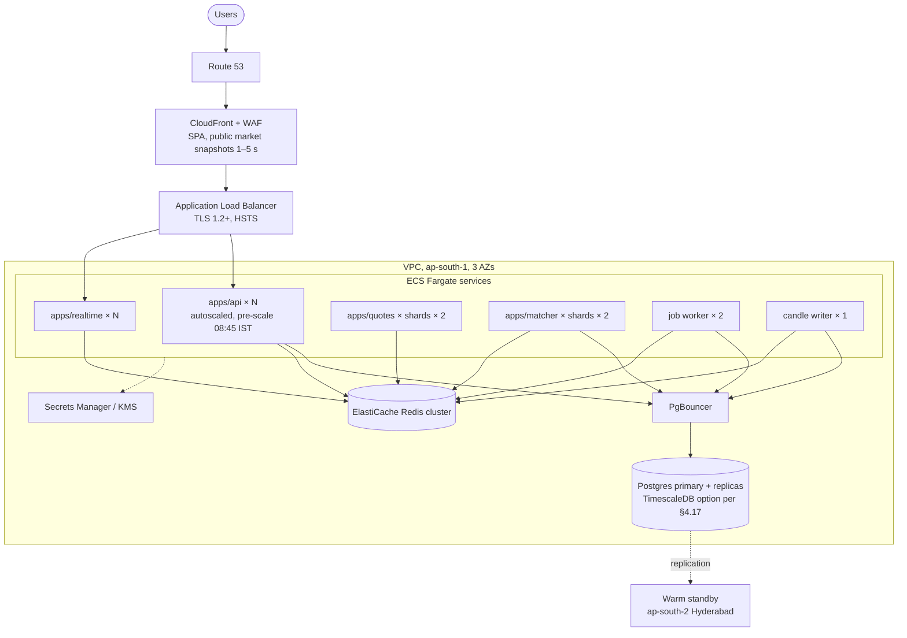

Terraform provisions it; each environment gets its own variables and secrets; EKS only if Fargate
limits are reached.

### 4.25 CI/CD and the agent team

**Branching (ADR 0010, 0011):** `develop` is the default branch and the development environment;
`production` is the live site. Feature branches → PR into `develop` → squash merge. Only Promote to
production moves `production` (fast-forward, or a merge commit with develop's exact tree; never a
force push). Conventional Commits scoped by issue key (`feat(NSTOCK-0001): …`), enforced by a check.

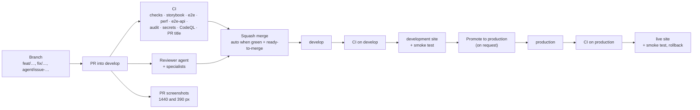

**CI pipeline (`.github/workflows/ci.yml`):**

| Job | What it proves |
|---|---|
| Lint, typecheck, test, build | Prettier, ESLint (incl. jsx-a11y, import boundaries, no raw hex), `tsc` strict, Vitest with coverage across every workspace (Postgres/TimescaleDB service for integration tests), `db:check`, production builds in both web modes, the bundle budget, OpenAPI freshness |
| Storybook build and a11y | Every story renders and passes axe; the low-contrast canary must fail |
| Playwright smoke (Chrome, WebKit) | msw-mode journeys, screenshots, the dev server without package `dist` |
| Web vitals and render budgets | LCP, INP, CLS, long animation frames, chart frame time, Lighthouse CI |
| Playwright golden path (api mode) | Full stack on Postgres + Redis: migrations, `db:check`, tick-to-screen latency, the golden path with an API restart mid-test, security journey, perf smoke with `pg_stat_statements` |
| Dependency audit · Secret scan · CodeQL | `npm audit --audit-level=high`, gitleaks, static analysis |

Scheduled CI runs on `develop` at 09:20 and 12:30 IST on weekdays and 20:00 IST daily; a red run
starts the Fixer.

**Agent team** (ADR 0003, 0006; roles in `.claude/agents/`, procedures in
[agent-workflow.md](agent-workflow.md)): Claude Code agents on GitHub Actions.

| Role | Trigger | Does |
|---|---|---|
| Planner | Issue labelled `plan:approved` | Writes the spec PR (`spec`) and story issues (`agent:backlog`) |
| Developer | Story labelled `agent:ready` | Implements one story on `agent/issue-<n>-<slug>`, opens a PR with `Closes #N` |
| Reviewer | PR opened or updated | Reviews with specialists (`frontend-reviewer`, `ux-design-reviewer`, `security-reviewer`, `database-reviewer`, `error-handling-reviewer`, `test-coverage-reviewer`); labels `ready-to-merge` or `agent:fix-needed` |
| Fixer | `agent:fix-needed`, red CI on a PR, or red CI on `develop` | Pushes the root-cause fix to the same PR, or opens `agent/fix-develop-*` |
| Merge-conflict resolver | Push to `develop` that conflicts with an open PR | Merges `develop` into the PR branch; hands real conflicts to the Fixer |
| Auto-merge | Green PR with `ready-to-merge` | Squash-merges; spec PRs, production release/deploy workflows, `.env` files and data-dropping migrations wait for the owner |
| Housekeeping | PR events, schedules | Close done issues and epics, sync labels, key issues `NSTOCK-NNNN`, promote stories after a spec merges, delete merged branches |

Claude Code hooks (`.claude/hooks/`) give local and cloud agent sessions the same checks while they
edit: format and lint after each edit, typecheck at the end of a turn, guards against pushing to
`develop` or `production` and editing secrets or generated files.

### 4.26 Security architecture

**Trust boundaries and controls:**

| Boundary | Threats | Controls (where) |
|---|---|---|
| Browser ↔ edge | XSS, clickjacking, MITM | Strict CSP on the SPA (`script-src 'self'`), `X-Frame-Options DENY`, HSTS preload, no inline scripts, React escaping, `nosniff`, `Referrer-Policy no-referrer` (`app/config/securityHeaders.ts`, `http/securityHeaders.ts`) |
| Browser ↔ API | CSRF, session theft, brute force, enumeration | SameSite=Strict httpOnly cookies, CSRF header + per-session token, refresh rotation with reuse detection, rate limits, CAPTCHA after 3, PIN lock after 5, OTP burn after 5, uniform 401s |
| Browser ↔ realtime | Unauthenticated streams, cross-user leakage | JWT on upgrade, revocation check, per-user channels with `userId` cross-check, 200-symbol cap, 1 MB backpressure |
| API ↔ data | SQL injection, privilege misuse, tampering | Drizzle parameterised queries, DML-only app role, append-only audit (privileges + trigger), CHECK constraints on every enum and money column, optimistic concurrency |
| Process ↔ process | Forged or malformed messages | Every Redis message parsed with its Zod contract; malformed entries skipped or dead-lettered; user ids checked against channels |
| Secrets | Leaks in a public repo | `.env.example` only; dev keys derived from public strings and refused in production; `JWT_SECRET`, `PII_*` required in production; gitleaks in CI; Secrets Manager in Phase 6 |
| Supply chain | Vulnerable or hostile dependencies | Exact versions (`save-exact`), Dependabot, `npm audit`, CodeQL, images pinned by version or digest |
| Test-only surfaces | Test routes reaching production | `/v1/__test` refused unless `NODE_ENV=test`; dropped from web builds; `checkBuild.mjs` verifies |

The ASVS L2 checklist links every control to its test: [phase2-asvs-l2.md](security/phase2-asvs-l2.md).
**Planned:** TLS termination and WAF at the ALB, KMS encryption at rest, real SMS and CAPTCHA
providers before launch, MFA-protected admin access.

### 4.27 Observability

**Built:**

- Structured JSON logs from every process (Fastify's pino in the API; one JSON line per event in
  realtime, quotes, matcher, worker and writer), with no PII: ids only, database row values dropped,
  error class and attempt for jobs.
- Health: `GET /v1/health` (liveness) and `/v1/health/ready` (Postgres and Redis); readiness reports
  a degraded dependency while the process keeps serving what it can.
- Runtime counters: realtime `stats()` (connections, dropped frames, idle closes); matcher per-tick
  log (crossed, triggered, moved); fill reader errors logged at most once a minute; dead-letter
  stream for poison fills.
- Performance evidence in CI: latency tests, web vitals, Lighthouse, perf smoke with
  `pg_stat_statements`, all uploaded as artifacts.

**Planned (Phase 6):** OpenTelemetry traces and metrics → Grafana (Prometheus, Loki, Tempo); Sentry
for frontend errors; real-user Web Vitals with regression alerts; SLO dashboards for tick-to-screen,
API p95, fill latency and stream lag; alerts on lease churn, dead-letter growth and outbox age.

### Performance and capacity

| Measure | Result | Source |
|---|---|---|
| Concurrent users on one API + one realtime process (4 vCPU) | 10,000 logged in, 10,000 sockets, zero errors | [load-test.md](runbooks/load-test.md) |
| API inside 200 ms p95 | 7,500 users at 1 call / 5 s (1,326 req/s); 10,000 users at 1 call / 15 s (88 ms p95) | load test |
| Login burst | about 550 logins a second, p95 under 0.5 s | load test |
| Realtime | 10,000 sockets, about 10,900 frames a second, 40% of one core, 456 MB, no dropped frames | load test |
| Tick to screen | p95 240 to 260 ms via the quote service; 86 to 106 ms via the tick pump | `test:latency` in CI |
| Matcher book work | p95 0.06 ms per tick at 2,000 ticks/s over 1,00,000 resting orders and 10,000 stops; 6.8 heap entries read per tick vs 220 for a full walk | `tools/loadTest/matcher.mjs` |
| Tick to fill commit | about 10 ms p95 (Redis hop 3.1 ms, Postgres commit 6.5 ms); one API process commits 550 to 650 fills a second | `matcherFill.latency.test.ts` |
| Perf smoke (10,000 seeded users) | order ack p95 29.6 ms, PIN login p95 42.1 ms, slowest query p95 0.6 ms | [perf-smoke.md](runbooks/perf-smoke.md) |
| Chart on a 390 px phone | frame p95 16.7 ms, no dropped frame in 488, no long frame at 4× CPU throttle | `chartTradingPerf.spec.ts` |

### Scalability rules

- **API:** no state in the process (sessions, OTPs, revocations and rate limits in Redis, data in
  Postgres); add processes behind the load balancer, about 1,300 requests a second each on the test
  hardware. With `MATCHER_MODE=worker` and the quote service, API processes follow no ticks, and
  every one joins the fill consumer group, so fill capacity grows with them.
- **Realtime:** add nodes; each reads the tick streams and subscribes only the channels of users it
  holds. Only subscribed symbols are sent, conflated to 4 updates a second, in binary frames.
- **Quotes and matcher:** raise `SHARDS`; keys, leases and the `orders.shard` column are already per
  shard. Run two processes per shard for failover within the lease TTL.
- **Postgres:** PgBouncer in transaction mode (in Compose, profile `pool`); read replicas for history
  pages; `orders` partitioned by trade date; shard by `user_id` (Citus) only when needed.
- **Redis:** Redis Cluster; every key is per shard or per user, so it spreads without cross-slot work.
- **Schedule:** pre-scale at 08:45 IST, reactive autoscaling through the day, scale down after 15:45.
- **Caching:** CDN for static assets and public market snapshots (1 to 5 s TTL); Redis for quotes,
  sessions and hot lists.
- **Load shedding:** under overload shed non-critical features first (promos, movers, chart history);
  login, prices and orders stay up.
- **Load-test plan:** k6 from 1 lakh to 10 lakh concurrent sockets and 50k logins a second, and one
  test near 1 crore before launch.

### Resilience and failure modes

| Failure | Effect | Recovery |
|---|---|---|
| API process dies | Its in-flight requests fail; clients retry | Stateless restart; accounts reload from Postgres on first use; resting orders reloaded at boot; its unacked fills claimed by another process after 30 s |
| Commit loses to another writer | Second writer's change would be lost | Optimistic version check; reload and retry once (3 times for matcher fills), else 409 |
| Postgres down | Writes fail with 500; readiness reports it | API keeps serving market data; sweep and matcher reconcile retry; reads bounded by timeouts |
| Redis down | No ticks, no fan-out; shared rate limits fail open | Followers retry; on return they resync from snapshots on the `seq` gap; outbox republishes notifications; commands missed are repaired by the 60 s reconcile |
| Quote writer dies | Ticks stop for its shard | Standby takes the lease within 5 s; consumers resync on the restarted `seq` |
| Matcher dies | Crossings in its shard wait | Standby is already following and takes the lease; reconcile on start rebuilds books |
| Lost matcher command | A book misses an order change | Reconcile from a REPEATABLE READ snapshot within 60 s |
| Poison fill request | Could block a consumer | Dead-lettered after 5 deliveries; reconcile restores the order |
| Realtime node dies | Its sockets drop | Clients reconnect with jitter to another node, resubscribe, the trading store re-reads state |
| Lost WebSocket frames | A surface could lag | `seq` gap detection re-reads account state; visibility sync takes a REST snapshot |
| Candle writer dies | Minutes not stored yet | Unacked entries re-read on restart; upserts are idempotent |
| Job worker dies mid-job | A session event half done | BullMQ retries; jobs are idempotent by account version; one run per scheduled time |
| Chrome stops the MSW worker (demo) | Mock requests would fail | `ensureActive` before each request; reload once after a hard reload |

## 5. Monorepo structure

npm workspaces + Turborepo. Node 22 pinned in `.nvmrc`; `.npmrc` sets `engine-strict=true` and
`save-exact=true`. Updated 2026-10-25.

```
nthstock/
├── CLAUDE.md                     # short project memory for Claude; links everything below
├── apps/
│   ├── web/                      # Vite React SPA (ADR 0005, 0012)
│   │   ├── e2e/                  # Playwright specs (msw and api mode, perf, walkthrough, screens)
│   │   ├── public/               # static files, MSW worker (generated), demo video
│   │   ├── scripts/              # post-build budget checks and guards (no raw hex, import cycles)
│   │   └── src/
│   │       ├── main.tsx          # boot: runtime config, mocks, providers, router
│   │       ├── app/              # app-wide wiring, never imported by features
│   │       │   ├── config/       # runtime config, dev proxy, security headers
│   │       │   ├── layouts/      # AppShell, Header, LeftRail
│   │       │   ├── live/         # quote socket, trading store binding, visibility sync
│   │       │   ├── providers/    # AppProviders and contexts
│   │       │   ├── router/       # router factory and route guards
│   │       │   ├── store/        # app-shell UI state (Zustand)
│   │       │   ├── queryClient.ts
│   │       │   └── strings.ts
│   │       ├── routes/           # TanStack Router file routes; thin: loader prefetch → feature page
│   │       ├── features/<feature>/
│   │       │   ├── index.ts      # the only import surface of the feature
│   │       │   ├── strings.ts    # every UI string of the feature
│   │       │   ├── api/          # query keys, queries and mutations
│   │       │   ├── components/   # PascalCase .tsx, tests beside them
│   │       │   ├── hooks/        # useX.ts
│   │       │   ├── model/        # pure logic and types
│   │       │   └── store/        # Zustand slices (only when needed)
│   │       ├── shared/           # cross-feature components, hooks, lib
│   │       ├── mocks/            # MSW handlers, the in-browser mock market, demo simulator
│   │       ├── styles/           # global CSS (token imports, Tailwind base layer)
│   │       └── test/             # render wrappers, fixtures, browser API stubs
│   ├── api/                      # Fastify modular monolith (+ job worker and candle writer entries)
│   │   ├── drizzle/              # SQL migrations 0000–0019 and Drizzle metadata
│   │   └── src/
│   │       ├── app.ts            # buildApp: plugins, hooks, modules, error handler
│   │       ├── server.ts         # API process entry
│   │       ├── worker.ts         # BullMQ job worker entry
│   │       ├── candleWriter.ts   # candle writer entry
│   │       ├── config.ts         # env parsing and cross-checks (Zod)
│   │       ├── deps.ts           # storage seams and wiring: memory or Postgres, streams
│   │       ├── db/               # Postgres client, migrations runner, column crypto, schema check
│   │       │   └── schema/       # Drizzle tables, one file per area
│   │       ├── http/             # errors, cookies, CSRF, security headers, route registration
│   │       ├── modules/<module>/ # index.ts (public API), routes.ts, service.ts, repo.ts
│   │       │                     # (interface + memory), pgRepo.ts (Postgres), schema.ts, tests
│   │       ├── ticks/            # tick pump, publisher, quote-stream follower
│   │       ├── perf/             # perf smoke
│   │       └── test/             # injected backend, test Postgres/Redis, contract suites
│   ├── quotes/                   # tick writer: one process per shard behind a Redis lease (E22)
│   ├── matcher/                  # order books per shard: commands, reconcile, fills, alerts (E23)
│   ├── realtime/                 # WebSocket gateway
│   │   └── src/
│   │       ├── app.ts, server.ts, config.ts, logger.ts, protocol.ts, timers.ts
│   │       ├── connections/      # auth, per-connection hub, subscription registry
│   │       ├── feeds/            # quote (pub/sub or streams), order, session-revocation feeds
│   │       └── test/             # fake sockets, WS test client, test Redis
│   └── mobile/                   # (later) React Native + Expo
├── packages/                     # each: src/index.ts is the public API; tests beside the code
│   ├── ui/                       # design system components + Storybook
│   ├── tokens/                   # design tokens → CSS variables + Tailwind theme
│   ├── contracts/                # Zod schemas: REST routes, WS, pub/sub, streams, OpenAPI, scenarios
│   ├── marketData/               # adapter, mock market (faker + GBM), leases, stream follower
│   ├── paperEngine/              # engine, desk, order book, trailing stops, alerts (ADR 0004)
│   ├── apiClient/                # typed REST + WS client, quote and trading stores (web and mobile)
│   ├── config/                   # eslint, tsconfig, prettier, vitest presets
│   └── utils/                    # INR formatting, IST time, NSE calendar, TOTP, shardOf
├── infra/                        # docker-compose (Postgres+TimescaleDB, Redis, PgBouncer), k6
├── tools/                        # github/issueKey.sh, loadTest/, demo/ walkthrough recorder
├── docs/                         # see docs/README.md
├── .claude/                      # see "Claude Code setup" in CLAUDE.md
└── .github/                      # workflows, PR template, CODEOWNERS, Dependabot
```

## 6. Decisions, risks and open questions

**Decision records** ([`adr/`](adr/)):

| ADR | Decision |
|---|---|
| [0001](adr/0001-monorepo-npm-turborepo.md) | npm workspaces + Turborepo monorepo |
| [0002](adr/0002-core-stack.md) | Core stack: React/Vite SPA, Fastify, Postgres, Redis |
| [0003](adr/0003-agent-team-on-github-actions.md) | Agent team on GitHub Actions |
| [0004](adr/0004-mock-backend-and-paper-engine.md) | Mock backend (MSW and API) on one paper engine and market adapter |
| [0005](adr/0005-web-ui-architecture.md) | Web UI architecture: layers, state, live prices |
| [0006](adr/0006-auto-merge-and-self-healing.md) | Auto-merge and self-healing CI |
| [0007](adr/0007-postgres-persistence-and-jobs.md) | Postgres persistence, roles, PII crypto, jobs |
| [0008](adr/0008-repository-structure-and-claude-setup.md) | Repository structure and Claude Code setup |
| [0009](adr/0009-agent-driven-releases.md) | Agent-driven releases (superseded by 0011) |
| [0010](adr/0010-develop-and-main-branches.md) | `develop` and `production` branches and environments |
| [0011](adr/0011-agent-promoted-releases.md) | Agent-promoted releases with gates |
| [0012](adr/0012-trading-state-and-chart-gestures.md) | One trading state for every surface; chart gesture zones |
| [0013](adr/0013-matcher-fills-commit-in-api.md) | The matcher finds fills, the API commits them |

**Risks and how they are contained:**

| Risk | Containment |
|---|---|
| TimescaleDB is not on RDS | Queries are plain `time_bucket` reads; three fallbacks listed in the spec |
| One API process commits 550 to 650 fills a second, so a burst queues | Fill reader is a consumer group: more API processes add capacity linearly |
| Pub/sub for per-user events is fire and forget | Every consumer resyncs on a `seq` gap or reconnect; notifications ride an outbox |
| Mock SMS and CAPTCHA fail closed in production | A launch checklist item; interfaces are in place |
| Simulated data could be mistaken for real | Paper trading only; the Demo simulator is labelled "Simulated" |

**Open questions:** the TimescaleDB hosting choice for AWS (spec market-data-and-matching, question
1); when to make `MATCHER_MODE=worker` the default for the local stack; the observability vendor
for Phase 6.
