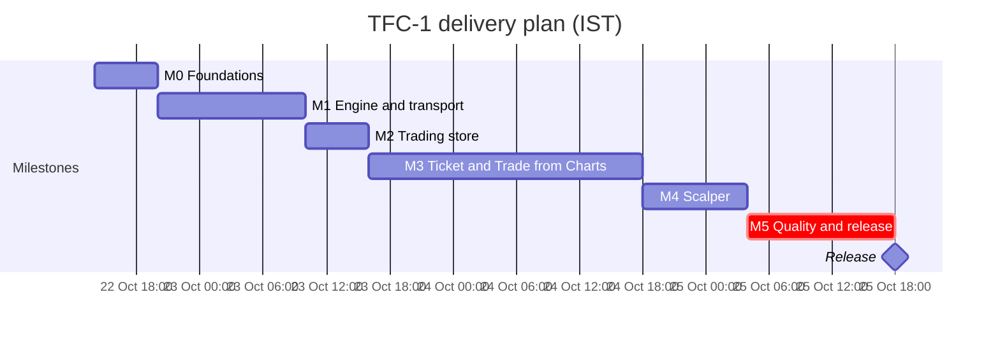

# Trade from Charts (TFC-1): delivery plan

| | |
|---|---|
| Document | PLAN-TFC-1 |
| Version | 1.0 (approved) |
| Date | 2026-10-22 |
| Product owner and approver | Naresh Payani |
| Specification | [SPEC-TFC-1](trade-from-charts.md) |
| Requirements | [Compliance matrix](trade-from-charts-traceability.md) |
| Target release | 2026-10-25 |

## 1. Summary

Thirty tasks in seven epics deliver the specification in three days, through six milestones.
Total effort is about 96 engineering hours, so the plan runs three workstreams in parallel
(Engine and platform, Frontend, Quality) along one critical path. Each task is one pull request
into `develop` with several focused commits, reviewed automatically and squash-merged (TFC-04).

## 2. Milestones

| Milestone | Target (IST) | Exit criteria |
|---|---|---|
| M0 Foundations | 22 Oct, 20:00 | Contracts merged; demo market always open; mobile and WebKit test projects in CI; production cold load checked on an iPhone |
| M1 Engine and transport | 23 Oct, 10:00 | Every §6 rule passes in unit tests; `accountDelta` frames and `/v1/trailing-stops` work in the mock; Simulator usable |
| M2 Trading store | 23 Oct, 16:00 | Existing pages run on the store with no visible change; consistency test green |
| M3 Ticket and Trade from Charts | 24 Oct, 18:00 | US-01 to US-04 pass on Chromium mobile and desktop; production rehearsal done; real-device check |
| M4 Scalper | 25 Oct, 04:00 | US-05 passes; safety model tested |
| M5 Quality and release | 25 Oct, 18:00 | Go/no-go checklist (§6) complete; production promoted; walkthrough recorded |

## 3. Critical path

T01 → T02 → T05 → T06 → T08 → T10 → T15 → T16 → T17 → T20 → T26 → T28 → T29 → T30

Work off the critical path runs alongside it: T03, T04 and T27 on day 1; T07 and T09 with the
engine; T12 to T14 and T18 to T19 with the chart overlay; T21 to T23 once T12 lands.

## 4. Descoping order

If a milestone slips, scope is removed in this order, and the compliance matrix is updated to match:

1. Depth-driven partial-fill caps (T05; Simulator-forced splitting stays).
2. Limit exit with an offset (T13; Market exit stays).
3. Edge-pinning arrows for off-screen lines (T15).
4. Overlap picker for stacked handles (T15; vertical offset stays).
5. The 360 px journey run (T26; 390 px stays).

**Not in this release:** trailing stops in `apps/api`, several trailing stops per position, SL and
SL-M, bracket and OCO orders, haptics.

## 5. Tasks

Sizes: S up to 2 hours, M 2 to 4 hours, L 4 to 8 hours. Workstreams (WS): **ENG** engine and
platform (packages and mocks), **FE** frontend, **QA** quality and release, **PO** product owner.
Every task's pull request passes `npm run check` and lists its requirement IDs.

### Epic TFC-A: Contracts, engine and simulated market (M0, M1)

| ID | Task | WS | Size | Depends on | Requirements | Done when |
|---|---|---|---|---|---|---|
| T01 | Contracts: `TrailingStop`, `TrailingStopStatus`, `TrailingStopParams`, `Trail` union, `attachedTrailingStop`, order `validity` (`DAY`, `IOC`), `PARTIALLY_EXECUTED`, `WsAccountDelta`, `AccountState`, `seq` on command responses, route names | ENG | M | – | REQ-TSLO-01 to 05, REQ-TKT-01 | Schemas, fixtures and tests exist; `apps/api` compiles and its tests pass |
| T02 | `trailingStop.ts`: `stepTrailingStop`, `previewTrailingStop`, `validateTrailingStop`, modify rule | ENG | M | T01 | REQ-TSLO-01 to 08, REQ-TSLO-11 | Unit and property tests cover activation, ratchet only, short mirror, rupee and percent trails, tick rounding, gap-through firing once, a modify widening the trail, and every §6.6 message; the preview equals the first engine step |
| T03 | Always-open demo market: `marketHours: 'nse' \| 'alwaysOpen'` in `PaperEngine` and `PaperDesk`, wired from `VITE_MOCK_MARKET_OPEN` | ENG | S | – | REQ-DEL-02 | A test pinned to 21:00 IST fills Delivery and Intraday orders in always-open mode and still refuses them in NSE mode |
| T05 | Partial fills and IOC: `OPEN → OPEN` partial transition, volume-weighted average, pro-rata cash release, per-tick cap (Simulator-forced; depth-driven is Should), marketable limits fill at the better price, IOC cancels the remainder | ENG | L | T01 | REQ-TSLO-12, REQ-SCP-02 | Engine invariant, funds ledger, state machine and dual-backend tests updated and green; a 10-share limit fills 3 + 3 + 3 + 1 under a cap of 3 |
| T06 | Trailing-stop lifecycle in the engine: standalone and attached stops, `PENDING_ENTRY`, `protectedQty`, reduce-only exits, `closePosition`, auto-cancel, day expiry, `REJECTED` on a failed exit, `seq`, snapshot v2 with v1 migration, desk indexing of instruments with active stops | ENG | L | T02, T03, T05 | REQ-TSLO-06 to 13 | Engine tests cover every §6.4 rule, including a same-tick manual exit and trigger with no flip, an attached stop cancelled with its entry, partial entry and exit fills, and restore from a v1 snapshot |
| T07 | Simulated market: per-instrument random streams, 250 ms lane for the focused instrument, timestamped catch-up replay, tick-built 1-minute bars merged into 1D candles, `nudge` and `gap` | ENG | L | T01 | REQ-TSLO-10, REQ-MOB-03 | A fake clock that jumps 5 minutes replays the missed ticks once, in order, with timestamps; a 30-minute replay of one instrument runs under 100 ms; seeded snapshot tests updated |
| T08 | Mock transport: `/v1/trailing-stops` routes, `/v1/account/state`, `accountDelta` per flush with the focused instrument's depth, throttled persistence, API-mode capability flag | ENG | M | T06, T07 | REQ-TFC-08, REQ-TSLO-10 | Handler tests cover place, modify, cancel, trigger, reload and a `seq` gap; one frame carries the quote, depth and order change from the same tick |
| T09 | Demo Simulator: Rally +1%, Pull back −1%, Gap −3%, Split large fills; labelled "Simulated"; present only when demo mode is on | FE | S | T08 | REQ-DEL-03 | A scripted gap triggers a trailing stop in a mock-backed test; the controls are absent outside demo mode |

### Epic TFC-B: One trading state (M2)

| ID | Task | WS | Size | Depends on | Requirements | Done when |
|---|---|---|---|---|---|---|
| T10 | Trading store in `packages/apiClient`: `accountDelta` handling in the socket client, one commit per animation frame shared with the quote store, `seq` checks and re-read, pending intents with a 5-second timeout, write-through to query caches, cleared on sign-out; `useTradingSelector` | FE | L | T08 | REQ-TFC-08 | Store tests cover stale and gapped `seq`, pending then acknowledged, pending then rejected, timeout, and sign-out |
| T11 | Existing surfaces on the store: positions, orders and depth; toasts and announcements per fill event; `3 / 10 filled`; trailing-stop status and stop on rows | FE | M | T10 | REQ-TFC-08, REQ-TSLO-09 | Existing E2E passes unchanged; a new test shows a fill updating positions, orders and depth in the same frame |

### Epic TFC-C: Order ticket (M3)

| ID | Task | WS | Size | Depends on | Requirements | Done when |
|---|---|---|---|---|---|---|
| T13 | Trailing SL order type for an open position: unit, value, activation, exit type and limit offset (Should), fixed quantity, product choice, validation, charges | FE | M | T10 | REQ-TKT-01 to 05 | Component tests cover each §6.6 message, the product choice and the charges; a placed stop appears in the store |
| T14 | "Add trailing stop" on Market and Limit entries; live preview; review-step wording | FE | M | T13 | REQ-TKT-02, REQ-TKT-03, REQ-TFC-05 | An entry with an attached stop fills and the stop arms in a mock-backed test; preview tests cover rupee, percent, activation and short wording |

### Epic TFC-D: Trade from Charts (M3)

| ID | Task | WS | Size | Depends on | Requirements | Done when |
|---|---|---|---|---|---|---|
| T15 | Chart overlay foundation (`features/chartTrading`): `onReady`, price lines, series primitive that positions DOM handles on each repaint, gesture options, gutter, edge pinning (Should), collision offsets | FE | L | T10, T12 | REQ-TFC-01, REQ-MOB-03 | Handles stay aligned during pan, pinch and autoscale; a render-count test shows no React render per tick |
| T16 | Order lines: buy and sell styles with labels; drag to modify with the pending price on every surface and one modify on release; two-tap cancel; drag aborted by a fill | FE | M | T15 | REQ-TFC-01, REQ-TFC-02 | E2E on Chromium mobile and desktop drags and cancels a limit; a fill during the drag snaps the line back with an announcement |
| T17 | Place from the chart: gutter tap, draggable ghost line, Buy and Sell chips, compact sheet with inline trailing stop, immediate-fill warning | FE | M | T16, T14 | REQ-TFC-03, REQ-TFC-05 | E2E places a limit by dragging a ghost line and attaches a trailing stop (US-01, US-02) |
| T18 | Position line and chip with live P&L; trailing-stop sheet with set, update and cancel | FE | M | T15, T13 | REQ-TFC-04, REQ-TFC-06 | E2E sets, updates and cancels a stop from the chip; P&L changes with the price; a pan that starts on the chip pans |
| T19 | Trailing-stop line: status display (including waiting and armed), ratchet, drag to change the trail | FE | M | T18 | REQ-TFC-06, REQ-TFC-07, REQ-TSLO-09 | With the Simulator, the line rises on a rally, holds on a pullback, and the drag changes the trail (US-04) |
| T20 | Gesture hardening: drag threshold, cancel rules, tap versus pan, iOS Safari specifics; touch E2E for every row of the gesture table | FE | M | T17, T19, T04 | REQ-MOB-01, REQ-MOB-02 | Chromium mobile and WebKit iPhone E2E cover each gesture row; pinch uses a CDP touch helper |

### Epic TFC-E: Phone experience (M0, M3)

| ID | Task | WS | Size | Depends on | Requirements | Done when |
|---|---|---|---|---|---|---|
| T04 | Test projects: Chromium mobile (390 × 844, touch) and WebKit iPhone in Playwright; CDP touch helper; production cold-load check on an iPhone | QA | M | – | REQ-MOB-05, REQ-DEL-02 | Both projects run in CI on an existing journey; the iPhone check result is recorded on the pull request |
| T12 | Shared bottom sheet and phone instrument layout: chart at about 55% height, tabs, position strip, sticky bottom bar; desktop unchanged | FE | M | T10 | REQ-MOB-04, REQ-MOB-06 | Screenshots at 360, 390 and 414 px show no horizontal scroll; targets of at least 44 px asserted; primary actions in the lower 40% |

### Epic TFC-F: Scalper (M4)

| ID | Task | WS | Size | Depends on | Requirements | Done when |
|---|---|---|---|---|---|---|
| T21 | Scalper pad (`features/scalper`): Scalp switch, quantity chips with remembered size, Buy at ask and Sell at bid as IOC, position strip, acknowledgement chips, rejection feedback | FE | M | T12, T11 | REQ-SCP-01 to 04 | E2E buys and sells from the pad at 390 px; acknowledgement, P&L and announcement asserted |
| T22 | Flatten and Reverse through `closePosition`; Arm switch with disarm on idle, hidden page and leaving; Reverse hold | FE | M | T21 | REQ-SCP-03, REQ-SCP-05 | Fake-clock tests show disarm on each trigger, nothing sent while disarmed, and Reverse requiring the hold |
| T23 | Scalp position to trailing stop: the position strip and chart chip open the sheet; Flatten cancels the stop | FE | S | T22, T18 | REQ-SCP-06 | E2E scalps, sets a stop, flattens, and sees the stop cancelled (US-05) |

### Epic TFC-G: Quality and release (M5)

| ID | Task | WS | Size | Depends on | Requirements | Done when |
|---|---|---|---|---|---|---|
| T24 | Accessibility: keyboard handles, hidden "Chart orders" list, live region and alert; axe for the chart, sheets, ticket and scalper | FE | M | T20, T23 | REQ-MOB-07 | A keyboard-only E2E modifies and cancels an order and sets a stop; axe reports no serious violations |
| T25 | Performance: frame-time and long-animation-frame harness; scenario with ticks, drag and scroll; fixes | QA | M | T20, T21 | REQ-MOB-03 | Specification §12 targets met in CI; numbers recorded for the design rationale |
| T26 | Journey E2E US-01 to US-05 on Chromium mobile, WebKit iPhone and desktop; one run at 360 px; new routes in `e2e/screens/screens.ts`; deployed smoke at 390 px from a cold load with Try demo | QA | M | T09, T17, T19, T23, T27 | REQ-DEL-01 to 03 | All journeys green in CI |
| T27 | "Try demo" on the login page, released to production as the M3 rehearsal | FE | S | – | REQ-DEL-02 | A cold load of the development URL reaches the instrument page in two taps; the rehearsal promote succeeds |
| T28 | Design rationale (`WRITEUP.md`, eight sections), demo script, clean-checkout run instructions | PO, QA | M | T25, T26 | REQ-WRT-01 to 08, REQ-GR-03 | The product owner approves; each technical claim links to code or a test; performance numbers come from T25 |
| T29 | Release: go/no-go checklist, Promote to production, device verification | QA, PO | S | T24, T25, T26, T27, T28 | REQ-DEL-02 | Checklist in §6 complete and recorded on the release issue |
| T30 | Demo walkthrough: three minutes or less, recorded on a phone from production; linked from the design rationale | PO | S | T29 | REQ-DEL-04 | Video link in `WRITEUP.md` |

## 6. Go/no-go checklist (T29)

Recorded on the release issue (#430), 2026-10-25.

- [x] `develop` CI green, including Chromium mobile, WebKit iPhone and desktop journeys
- [x] Development smoke test green (ADR 0011)
- [x] Performance targets met (specification §12)
- [x] axe clean; keyboard-only journey green
- [ ] Production cold load and Try demo verified on an iPhone (Safari) and an Android phone (Chrome).
      Deviation: verified by the deployed smoke at 390 px and the WebKit iPhone 13 journeys, not on
      physical phones
- [x] US-01 to US-05 run on a phone-sized touch screen: the scripted walkthrough (T30) on the
      production build. Deviation: emulated, not by hand on an iPhone
- [x] Simulator present in demo mode only
- [x] Design rationale approved; compliance matrix shows every requirement Met or a recorded deviation
- [x] Rollback commit identified: the `production` commit before the release, redeployed with the
      Promote to production workflow (`docs/runbooks/release.md`)

## 7. Working agreement

- Epics and stories are created on GitHub from this plan after the specification is approved, with
  `NSTOCK-` keys; stories are sub-issues of their epic (`.claude/rules/git-and-prs.md`).
- Pull request titles follow `feat(NSTOCK-NNNN): …`; bodies list the requirement IDs and
  `Closes #N`.
- Status is reported at each milestone in the project thread, and any descoping is recorded here and
  in the compliance matrix.
