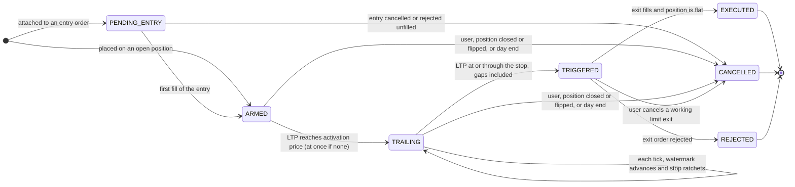
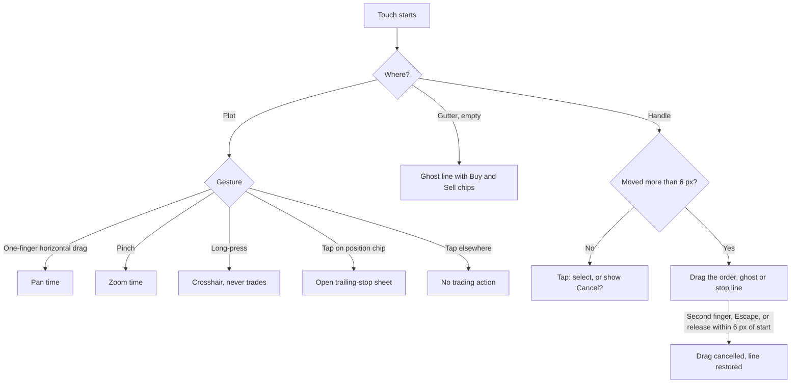
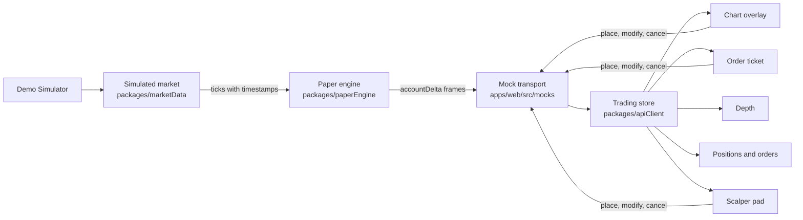
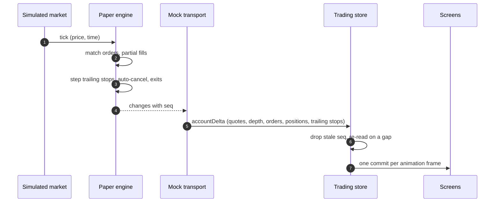
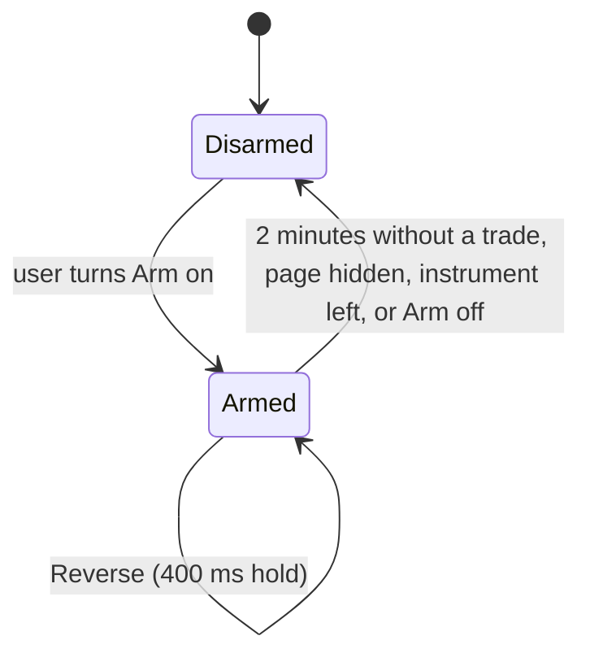

# Trade from Charts, Trailing Stop-Loss and Scalper: product and technical specification

| | |
|---|---|
| Document | SPEC-TFC-1 |
| Version | 1.0 (in review) |
| Date | 2026-10-22 |
| Product owner and approver | Naresh Payani |
| Release | Trade from Charts (TFC-1), target 2026-10-25 |
| Related | [Delivery plan](trade-from-charts-tasks.md) · [Requirements compliance matrix](trade-from-charts-traceability.md) · [ADR 0012](../adr/0012-trading-state-and-chart-gestures.md) · [Decisions, Round 9](../requirements-qa.md) |

**Version history**

| Version | Date | Change |
|---|---|---|
| 0.1 | 2026-10-22 | First draft |
| 1.0 | 2026-10-22 | Revised after architecture, requirements and documentation reviews: engine and transport corrections, complete TSLO rules, compliance matrix, delivery plan with milestones |

## 1. Executive summary

TFC-1 adds three trading capabilities to the nthstock instrument page, designed for phones first
(360 to 414 px) and kept fully usable on desktop:

1. **Trailing stop-loss order (TSLO).** An exit order whose stop follows the market in the
   favourable direction and never moves back. Available in the order ticket with full parameters
   and on the chart in a simplified form.
2. **Trade from Charts.** Working orders, the open position and its trailing stop appear as lines on
   the price chart. Users place, move and cancel orders, and set a trailing stop, directly there.
3. **Scalper mode.** A one-tap order pad for fast entry and exit, protected by an arming switch.

It remains paper trading on simulated market data (CLAUDE.md D2, D3). Three design decisions carry
the release:

- **The paper engine is the single authority.** Orders, fills, positions and trailing stops change
  only inside `packages/paperEngine`; every screen renders the same engine state from the same
  tick, so no two surfaces can disagree.
- **Gestures are assigned by zone.** The chart's plot pans and zooms, the price-axis gutter places
  orders, and lines move only by their handles, so no touch is ambiguous.
- **Speed with a safety catch.** Scalper buttons act in one tap, but only while the pad is armed.

The largest risk is schedule (thirty work items in three days). The
[delivery plan](trade-from-charts-tasks.md) runs three workstreams in parallel and names what is
descoped first.

## 2. Background

The requirements (Trade from Charts, TSLO and Scalper, Paytm Money, received 2026-10-22, held
outside the repository) ask for these capabilities on top of the existing nthstock application.
Today:

- the chart is read only (pan and zoom are disabled);
- orders fill in full on a single tick, so partial fills never occur;
- there is no stop or conditional order of any kind;
- orders reach the web app as `orderUpdate` socket messages that invalidate cached queries, while
  prices arrive separately, so two screens can briefly show different states;
- the simulated exchange follows NSE hours, so a demo opened in the evening cannot fill an order.

## 3. Glossary

| Term | Meaning |
|---|---|
| LTP | Last traded price of an instrument |
| Tick | One price update from the market feed; tick size is ₹0.05 |
| Paise, basis points | Money is stored as integer paise (₹1 = 100 paise); percentages as basis points (1% = 100 bp) |
| Delivery, Intraday | Product types. Delivery (CNC) is held overnight; Intraday (MIS) is squared off at 15:20 IST and may be short |
| Long, short | A positive or negative open quantity |
| TSLO, trailing stop | Trailing stop-loss order; shown in the app as "Trailing SL" |
| Trail | The distance between the watermark and the stop, in rupees or percent |
| Watermark | The highest price seen since activation for a long position (high-water mark), or the lowest for a short (low-water mark) |
| Stop price | The price at or through which the trailing stop triggers its exit |
| Activation price | Optional price the market must reach before trailing begins |
| Reduce-only | An order that can only shrink a position, never flip it |
| Marketable limit | A limit order priced at or through the best opposite price, so it fills at once |
| IOC | Immediate or cancel: fill what is available now, cancel the rest |
| Flatten, reverse | Close the whole position; close it and open the same size in the other direction |
| Depth | Best five bid and ask levels with quantities |
| Price-axis gutter | The 64 px strip on the right of the chart that carries the price axis |
| Handle | The grab target (44 × 44 px) attached to a line on the gutter |
| Ghost line | A provisional order line, not yet sent |
| Position chip | The label on the average-price line that opens trailing-stop options |
| Simulator | Demo-only controls that move the simulated price; always labelled "Simulated" |
| `seq` | Engine sequence number, increasing by one per engine change |

## 4. Goals, scope and assumptions

### 4.1 Scope

| Capability | In TFC-1 | Later | Not planned |
|---|---|---|---|
| Trailing stop in the order ticket (standalone and attached to an entry) | ✓ | | |
| Trailing stop on the chart (simplified) | ✓ | | |
| Place, move and cancel limit orders on the chart | ✓ | | |
| Position line with live P&L | ✓ | | |
| Scalper pad | ✓ | | |
| Partial fills | ✓ (Simulator-driven; depth-driven is Should) | | |
| Demo mode that trades at any hour | ✓ | | |
| Trailing stops in `apps/api` and `apps/realtime` (PostgreSQL) | | Phase 2 follow-up | |
| More than one trailing stop per position | | ✓ | |
| Plain stop-loss (SL, SL-M), bracket, cover, OCO | | ✓ | |
| Depth-of-market ladder in the scalper | | | ✓ (excluded by REQ-SCP-01) |
| Real-money trading, live market data | | | ✓ (CLAUDE.md D2, D3) |

### 4.2 Personas and journeys

- **Chart trader**, who reads the chart and wants to act at a price without leaving it.
- **Scalper**, who enters and exits within seconds and values speed and certainty.

| Journey | Description |
|---|---|
| US-01 | Place a limit order by dragging a line on the chart to a price |
| US-02 | Attach a trailing stop while placing an order from the chart |
| US-03 | Let the entry fill, tap the position, and set a trailing stop |
| US-04 | Watch the trailing stop ratchet with the price, then trigger and exit |
| US-05 | Scalp: arm, enter with one tap, flatten with one tap |

### 4.3 Assumptions

- Market data is the existing simulated feed; order matching runs in the browser (MSW mode), which
  is the mode the hosted site uses.
- One account per browser; the demo account is seeded on request.
- Supported for the new surfaces: Chrome (latest two) on Android and desktop, and Safari on iOS 17
  and later (TFC-16). Other surfaces keep CLAUDE.md D4.
- In demo builds the market is always open (§10.3); outside demo builds NSE hours apply unchanged.

### 4.4 Dependencies

No new third-party dependency. Existing: `lightweight-charts` 5.2.1, `@tanstack/react-query`,
`zustand` (scalper preferences only), `msw`. Internal: `packages/contracts`, `packages/paperEngine`,
`packages/marketData`, `packages/apiClient`.

## 5. Decisions

The product owner decided TFC-01 to TFC-06 and TFC-08 and approved engineering's recommended option
for the rest. Round 9 of [`docs/requirements-qa.md`](../requirements-qa.md) records each one.

| ID | Decision | Alternatives considered | Decided by |
|---|---|---|---|
| TFC-01 | Release on 2026-10-25 | Two-week plan | Product owner |
| TFC-02 | Phase 2 epics E15 to E21 resume after TFC-1; TFC-1 does not depend on them | Finish Phase 2 first | Product owner |
| TFC-03 | Simulated market data only; the trailing-stop engine is production-grade code in `packages/paperEngine` | Client-side simulation of the stop; a broker data feed | Product owner, on engineering's recommendation |
| TFC-04 | Squash merge; each pull request keeps several focused commits, visible on the pull request | Merge commits | Product owner |
| TFC-05 | The design rationale (`WRITEUP.md`) discloses the AI tools used, as the requirements ask; attribution elsewhere is unchanged | No disclosure | Product owner |
| TFC-06 | Engineering proposes each design decision with alternatives; the product owner approves; this table records them | Product owner designs each | Product owner |
| TFC-07 | Place from the chart by tapping the price-axis gutter; the ghost line can then be dragged; lines move only by their handles | Long-press, double-tap, drag line body, edit-mode toggle (§9.2) | Engineering, approved |
| TFC-08 | Scalper is a mode of the instrument page, not a separate route | Separate route | Product owner |
| TFC-09 | Scalper safety: Arm switch with automatic disarm; Reverse needs a 400 ms hold | Confirmation dialog; hold on every button | Engineering, approved |
| TFC-10 | Partial fills: limit orders only, capped per tick; the Simulator can force splitting; depth-driven caps are Should | Depth-driven only | Engineering, approved |
| TFC-11 | The focused instrument ticks every 250 ms; others every 1 s | 250 ms for all instruments | Engineering, approved |
| TFC-12 | Demo Simulator, visibly labelled "Simulated", demo mode only | Pre-scripted scenario | Engineering, approved |
| TFC-13 | Trailing stops protect Delivery longs and Intraday longs and shorts | Longs only | Engineering, approved |
| TFC-14 | Exit on trigger is Market by default; Limit with an offset in the ticket only | Market only | Engineering, approved |
| TFC-15 | Background resume replays the missed ticks so the stop behaves as if it never paused | Restart trailing from the current price | Engineering, approved |
| TFC-16 | iPhone Safari and Android Chrome supported for these surfaces | Chrome only (D4) | Engineering, approved |
| TFC-17 | The product owner records the demo walkthrough from a scripted shot list | | Engineering, approved |
| TFC-18 | Stakeholders use the production URL with a one-tap "Try demo" | OTP login | Engineering, approved |
| TFC-19 | Built through the project's agent workflow (`docs/agent-workflow.md`) with automated review on every pull request | | Engineering, approved |
| TFC-20 | Trading view opens on the 1D range with the last 60 minutes visible | | Engineering, approved |
| TFC-21 | An order line's price follows the finger on every surface while dragging; the modify is sent once, on release | A modify per animation frame | Engineering, approved (§9.3) |
| TFC-22 | Scalper orders are IOC marketable limits at the displayed price | Market orders | Engineering, approved (§11.2) |

## 6. Trailing stop: functional specification

### 6.1 Parameters

| Field | Type | Rules |
|---|---|---|
| `trail` | `{ unit: 'AMOUNT', amount: Paise }` or `{ unit: 'PERCENT', basisPoints: number }` | The user picks one unit |
| `activationPrice` | `Paise \| null` | Null: trailing starts at once |
| `exitOrderType` | `'MARKET' \| 'LIMIT'` | Market by default |
| `exitLimitOffset` | `Paise` | Limit only: the exit limit is `stopPrice − offset` for a long, `stopPrice + offset` for a short |

Engine-owned state: `status`, `watermarkPrice`, `stopPrice`, `protectedQty`, `exitOrderId`,
`statusReason`, `seq`, timestamps.

A trailing stop protects one position, identified by instrument and product (Delivery or Intraday),
in the position's direction. One trailing stop per position: placing another replaces it.

### 6.2 Lifecycle



| Status | Shown as | Meaning |
|---|---|---|
| `PENDING_ENTRY` | Waiting for entry | Attached to an entry that has not filled |
| `ARMED` | Armed | Waiting for the activation price |
| `TRAILING` | Trailing | Stop is live and ratchets |
| `TRIGGERED` | Triggered | Exit order sent and working |
| `EXECUTED` | Exited | Exit filled; position flat |
| `CANCELLED` | Cancelled, with the reason | No longer active |
| `REJECTED` | Exit failed, with the reason | The exit could not be placed; the position is unprotected and the user is alerted |

Every surface that shows a trailing stop (chart, ticket, position strip, positions page, orders
page) shows the status word; `TRAILING` and `TRIGGERED` also show the stop price. Terminal statuses
stay visible on the positions and orders pages and are announced once (§13).

### 6.3 Per-tick rules

`stepTrailingStop(state, tick)` is a pure function in `packages/paperEngine/src/trailingStop.ts`.
It runs for every active trailing stop on every tick of its instrument, in tick order, inside the
same engine step as order matching. The rules below are for a long position; a short mirrors every
comparison (minimum instead of maximum, stop above instead of below, ceiling instead of floor).

1. **Activation.** In `ARMED`, when `activationPrice` is null or `LTP ≥ activationPrice`, the
   status becomes `TRAILING` with `watermarkPrice = LTP`, and the stop is computed on the same
   tick. The stop is always below LTP at activation, so activation and trigger never occur on the
   same tick.
2. **Ratchet.** In `TRAILING`, `watermarkPrice = max(watermarkPrice, LTP)`. The trail in paise is
   `amount`, or `watermarkPrice × basisPoints / 10,000`. The candidate stop is
   `floorToTick(watermarkPrice − trail)`, and `stopPrice = max(stopPrice, candidate)`: the stop
   never moves against the position.
3. **Trigger.** When `LTP ≤ stopPrice`, the status becomes `TRIGGERED` and the engine places one
   reduce-only exit (§6.4). The comparison is "at or through", so a price that gaps well past the
   stop still triggers. A trailing stop in `TRIGGERED` or a terminal status ignores later ticks,
   so the exit is placed exactly once.

A standalone trailing stop starts from the LTP when it is placed. An attached trailing stop starts
from the entry's first fill price. `previewTrailingStop(params, ltp, side)` exports the same
arithmetic without state; the ticket and the chart use it to show the initial stop before
placement. After placement, every stop shown comes from the engine.

### 6.4 Quantity, exits and races

- `protectedQty` always equals the position's open quantity, recomputed after every fill: partial
  entry fills grow it, partial manual exits shrink it.
- **Reduce-only exits.** The trigger's exit is for `protectedQty` and is capped at the open
  quantity when it fills, so it can never flip the position, even when a manual exit fills on the
  same tick.
- **Auto-cancel.** When the position goes flat or flips by any other means (manual exit, opposite
  order, Flatten, Reverse, Intraday square-off), the trailing stop becomes `CANCELLED` ("Position
  closed"), and its working exit, if any, is cancelled in the same engine step.
- **One close path.** `closePosition(token, product)` is an engine command that, in one step,
  cancels the trailing stop and its exit, cancels working entry orders for that position, and sends
  a reduce-only market exit. Flatten, Reverse and the ticket's Exit use it.
- **Attached stops.** If the entry is cancelled or rejected before any fill, the attached trailing
  stop is cancelled. If the entry is partly filled and the rest cancelled, the stop protects the
  filled quantity. An attached trailing stop on an entry that adds to an already protected
  position replaces that position's trailing stop and protects the whole position; the review step
  says so.
- **Failed exits.** If the exit order is rejected, the trailing stop becomes `REJECTED` with the
  reason, and the app raises an alert. Engine-generated buy-backs of Intraday shorts settle like
  the existing forced square-off, so they are not rejected for lack of funds.
- **Limit exits.** A limit exit that does not fill stays working, shown as "Triggered · exit limit
  working at ₹X". The user may cancel it (the trailing stop becomes `CANCELLED`) or close the
  position.
- **Validity.** Trailing stops are valid for the day. Intraday ones are cancelled at the 15:20
  square-off and Delivery ones at the 15:30 close, both with the reason "Expired at close".

### 6.5 Modify

A modify sets a new trail (and optionally the activation price or exit type). The engine
recomputes `stopPrice = floorToTick(watermarkPrice − newTrail)` and uses it as the new ratchet
baseline, so a user can widen the trail as well as tighten it. Dragging the stop line on the chart
sends the new stop price; the engine converts it to a trail from the watermark at the moment it
applies the modify, so a moving market cannot make the client's conversion stale.

### 6.6 Validation

Enforced in the engine (authoritative) and mirrored in the ticket and chart as the user types or
drags.

| Rule | Message |
|---|---|
| No open position in the instrument and product | "Open a position first. A trailing stop protects an existing position." |
| Trail of zero or less | "Enter a trail greater than zero." |
| Effective trail (percent converted to rupees) below one tick, ₹0.05 | "The trail must be at least ₹0.05." |
| Rupee trail above 20% of LTP | "The trail can be at most 20% of the price (₹X)." |
| Percent trail below 0.10% or above 20.00%, or not a whole basis point | "Enter a trail between 0.10% and 20%." |
| Stop dragged to or through LTP | "That stop would trigger immediately." |
| Exit limit offset that puts the exit limit below ₹0.05 | "The limit offset is too large for this stop." |

An activation price on the far side of the market is accepted; it activates on the next tick, and
the preview says "Activates immediately".

### 6.7 Background, resume and reload

Phones pause timers in background tabs, and in demo mode order matching runs in the page. Resume
therefore behaves as if the engine had never paused:

1. Each instrument has its own random stream, so one instrument's prices can be advanced without
   the others.
2. When the market's timer fires more than two intervals late, it replays the missed ticks, with
   their timestamps, for every instrument that has a working order or an active trailing stop, up
   to 30 minutes of session time. Every other instrument advances in one exact step.
3. The engine processes the replay tick by tick and applies scheduled events (square-off, close) at
   the right timestamps. Watermark, stop and any trigger match continuous running.
4. Screens receive the coalesced result (the last price, with the high and low folded into the
   current 1-minute candle), so the chart shows the price that triggered a stop.

Limits, stated in the design rationale: a gap longer than 30 minutes, or a page that the browser
discarded and reloaded, is treated as one price move from the last saved price to the current one.
The exit still fires once, at the next price, if the stop was crossed.

Engine state is saved to `sessionStorage` when a status changes, otherwise at most every 2 seconds,
and when the page is hidden.

## 7. Order ticket

- Order type: Market, Limit, Trailing SL. Trailing SL appears when there is an open position in the
  instrument; it is then an exit for that position, with its quantity fixed to the open quantity
  and stated in the ticket. With both a Delivery and an Intraday position, the ticket asks which.
- Market and Limit entries offer "Add trailing stop" (attached), included in the review step,
  charges and cash check.
- Parameters: unit (₹ or %), value, optional activation price, exit type (Market, or Limit with an
  offset).
- A live preview updates with inputs and price: "Initial stop ₹1,480.00, trails 1.5% below the
  high (activates at ₹1,520.00)".
- Validation messages appear under the field (§6.6). The review step restates the behaviour in one
  sentence before confirmation.
- Delivery and Intraday, quantity, cash check and charges follow the existing ticket.

## 8. Trade from Charts

### 8.1 What the chart shows

| Object | Line | Handle and label |
|---|---|---|
| Working buy limit | Solid, brand blue | "Buy 10 @ ₹1,234.50", × to cancel |
| Working sell limit | Solid, down colour | "Sell 10 @ ₹1,250.00", × to cancel |
| Ghost order | Dashed, grey | Price label, Buy and Sell chips |
| Position | Solid, ink | Chip: "+10 @ ₹1,234.50 · +₹120.00" |
| Trailing stop | Dashed, amber | "Trailing SL ₹1,228.40 · 1.5% · Trailing" |
| Pending change | Dotted, at the new price | "Updating…" |

Every line carries a text label, so colour is never the only signal (CLAUDE.md §6). A trailing
stop in `PENDING_ENTRY` or `ARMED` has no stop line; its state appears on the position chip, and an
activation price, if set, is drawn as a thin dotted line.

### 8.2 Placing an order from the chart

1. Tap the gutter at a price. A ghost line appears there with Buy and Sell chips.
2. Drag the ghost line's handle to adjust the price (US-01). The label shows the price, snapped to
   ₹0.05.
3. Tap Buy or Sell. A compact bottom sheet opens with side, quantity, price, product, and "Add
   trailing stop" (unit and value). A buy above the LTP, or a sell below it, shows "This will fill
   immediately".
4. Tap Place. Nothing is sent before this.

### 8.3 Moving and cancelling an order

- Drag an order's handle. The price label and the pending line follow the finger, and the ticket,
  depth and orders list show the pending price at the same time (TFC-21). On release, one modify is
  sent.
- If the order fills or is cancelled during the drag, the drag ends, the line snaps to the real
  state, and the app announces it ("Filled at ₹1,234.50 before your change").
- Tap × once to show "Cancel?"; tap again within 3 seconds to cancel.

### 8.4 Position and trailing stop

- Tapping the position chip opens the trailing-stop sheet: status, current stop, unit and value
  (default 1.0%; in rupees, 1% of LTP rounded to ₹0.05), and Set, Update or Cancel. "More options"
  opens the full ticket.
- The trailing-stop line moves as it ratchets. Dragging its handle changes the trail (§6.5).
- When several handles fall within 44 px of each other, labels are offset vertically with leader
  lines. Hit priority is the active drag, then orders, then the trailing stop, then the position.

## 9. Interaction design

### 9.1 Gesture model



| Gesture | Zone | Result |
|---|---|---|
| One-finger horizontal drag | Plot | Pan time; vertical movement scrolls the page |
| Pinch | Plot | Zoom time |
| Long-press | Plot | Crosshair; never trades |
| Tap | Position chip | Opens the trailing-stop sheet. Detected by the chart's click event, which fires only for taps, so a pan that starts on the chip still pans |
| Tap | Gutter, empty | Ghost line at that price |
| Drag | Handle | Moves that line; the gutter captures the pointer, so the chart does not pan |
| Two taps | × on an order handle | Cancel |

### 9.2 Alternatives considered and rejected

| Alternative | Why rejected |
|---|---|
| Long-press to place | Collides with the crosshair, and is slow |
| Drag a line by its body | A 1 px line competes with pan; unreliable on touch |
| Edit-mode toggle | Adds a tap to every action |
| Double-tap to place | Accidental orders while zooming |

### 9.3 Live drag

The requirements ask that dragging modify the order "live". The price follows the finger on every
surface in real time, and the engine receives one modify on release. Sending a modify per frame
would let the order fill at an intermediate price the user only passed through.

### 9.4 Phone layout

```
┌──────────────────────────────┐
│ RELIANCE  ₹1,234.50  +0.8%   │  header
├──────────────────────────┬───┤
│                          │ ₹ │
│        chart (≈55%)      │ g │  gutter: tap to place,
│  ── Buy 10 @ 1,230.00 ───┤ u │  handles to drag
│  ── +10 @ 1,234.50 +₹120 │ t │
│  - - Trailing SL 1,228.40┤   │
├──────────────────────────┴───┤
│ 1D 1W 1M …                   │  range
│ Overview · Depth · Orders    │  tabs
├──────────────────────────────┤
│ +10 @ 1,234.50 · +₹120 · SL  │  position strip (tap: trailing stop)
│ [ Sell ]  [ Buy ]  ( Scalp ) │  sticky bottom bar
└──────────────────────────────┘
```

The ticket, the chart order sheet, the trailing-stop sheet and the scalper pad are bottom sheets
or bottom-anchored, with primary actions in the lower 40% of the screen, safe-area insets, and
targets of at least 44 × 44 px. Desktop keeps today's two-column layout; the same gutter and
handles work with a mouse.

**Deliberately left out on phones:** the market-depth card moves to a tab, the key-stats card moves
to the Overview tab, and hover tooltips are replaced by the long-press crosshair.

## 10. Architecture

### 10.1 State model



ADR 0012 records the architecture. The essentials:

- **Single authority.** Only the engine changes orders, positions and trailing stops.
- **One frame.** Every 250 ms flush sends one `accountDelta` message per connection: the quotes,
  the focused instrument's depth, and every order, position and trailing-stop change those ticks
  caused, tagged with the engine `seq`.
- **Trading store.** A framework-free store in `packages/apiClient` (beside the existing quote
  store, ADR 0005 UI-03) applies each frame in one commit, in the same animation frame as the
  quotes. It writes through to the existing TanStack Query caches, so pages off the instrument page
  agree, and it replaces the invalidate-on-`orderUpdate` path. A gap in `seq` triggers a re-read of
  `GET /v1/account/state`. The store is cleared on sign-out.
- **Pending intents.** Placements are keyed by `clientOrderId` (already idempotent); modifies and
  cancels by order id and request id. Each resolves on a response or frame with a `seq` at or
  beyond it. After 5 seconds without one, the store re-reads state and tells the user.
- **Per-tick painting skips React.** Lines and handles are positioned from the chart's own repaint
  cycle; React renders only when objects appear or disappear.

### 10.2 Tick to screen



The CLAUDE.md §3 target of tick to screen under 500 ms holds with a 250 ms flush plus one frame.

### 10.3 Engine and market changes

| Change | Where | Why |
|---|---|---|
| `marketHours: 'nse' \| 'alwaysOpen'` | `PaperEngine`, `PaperDesk` | The demo trades at any hour; wired from `VITE_MOCK_MARKET_OPEN` |
| Partial fills: `OPEN → OPEN` on a partial, volume-weighted `avgFillPrice`, pro-rata release of blocked cash, per-tick cap | `fillMatcher`, `orderStateMachine`, `fundsLedger`, `paperEngine` | REQ-TSLO-12 |
| Marketable limits fill at the better of limit and LTP; `IOC` validity cancels the remainder | `fillMatcher`, contracts | Scalper and drag-through-market |
| Instruments with an active trailing stop stay subscribed and stepped | `PaperDesk` | A stop must step even with no working order |
| Per-instrument random streams; focused instrument at 250 ms; timestamped catch-up | `mockAdapter` | §6.7, TFC-11 |
| Tick-built 1-minute bars merged into the 1D candles | `mockAdapter` | The chart agrees with triggers |
| `nudge(symbol, ratio)` and `gap(symbol, ratio)` | `mockAdapter` | The Simulator moves the real feed, so every screen agrees |
| Snapshot version 2 with `seq` and trailing stops; version 1 migrates | `paperEngine` snapshot, `mocks/handlers/orders.ts` | Existing demo state survives the release |

### 10.4 Code placement

| Code | Location |
|---|---|
| Trailing-stop arithmetic, lifecycle, `closePosition` | `packages/paperEngine` |
| Types, routes, socket messages | `packages/contracts` |
| Trading store | `packages/apiClient/src/tradingStore.ts`; React access through `apps/web/src/shared/hooks/useTradingSelector.ts` |
| Chart overlay, gutter, handles, trailing-stop sheet | New feature `apps/web/src/features/chartTrading` |
| Scalper pad | New feature `apps/web/src/features/scalper` |
| Composition | `features/stockDetail` imports both through their `index.ts` (ADR 0005) |

### 10.5 Chart implementation

- Order, ghost and trailing-stop lines use the library's price lines (`createPriceLine`, moved with
  `applyOptions`). A single series primitive draws the labels and the P&L pill. In its view update,
  called on every chart repaint, it recomputes `priceToCoordinate` for the DOM handles, so handles
  stay aligned during pan, pinch and autoscale. Its `autoscaleInfo` returns nothing, so a far order
  does not squash the candles; off-screen lines pin to the edge with an arrow.
- `PriceChartCanvas` gains an `onReady({ chart, series })` callback for the overlay.
- Chart options on the instrument page: horizontal touch drag on, vertical touch drag off (so page
  scroll keeps working), pinch on, price-axis drag scaling off (the gutter belongs to trading),
  axis double-click reset off, and a right price scale at least 64 px wide.
- The gutter overlay uses `touch-action: none`, pointer capture, and no text selection or callout;
  the chart container uses `overscroll-behavior: contain`.

### 10.6 Contracts and endpoints

| Contract | Content |
|---|---|
| `TrailingStop`, `TrailingStopStatus`, `TrailingStopParams`, `Trail` | §6.1, §6.2 |
| `PlaceTrailingStopRequest`, `ModifyTrailingStopRequest` | Position key and params; modify also takes `stopPrice` (§6.5) |
| `PlaceOrderRequest.attachedTrailingStop` | Optional params |
| `PlaceOrderRequest.validity` | `'DAY' \| 'IOC'`, default `DAY` |
| `OrderHistoryEvent` | Adds `PARTIALLY_EXECUTED` |
| `WsAccountDelta` | `{ seq, quotes, depth?, orders, positions, trailingStops }` |
| `AccountState` | `{ seq, orders, positions, trailingStops, funds }` |

| Method and path | Route name |
|---|---|
| `GET /v1/trailing-stops` | `trailingStopsList` |
| `POST /v1/trailing-stops` | `trailingStopPlace` |
| `PATCH /v1/trailing-stops/:id` | `trailingStopModify` |
| `DELETE /v1/trailing-stops/:id` | `trailingStopCancel` |
| `GET /v1/account/state` | `accountState` |

Command responses carry `seq`. In API mode these routes return 501 until the Phase 2 follow-up, and
a runtime capability flag hides the trailing-stop controls behind "Not available in this mode"
rather than showing an empty state.

## 11. Scalper mode

### 11.1 Layout

The Scalp switch replaces the bottom bar with the pad; the chart stays on screen.

```
│ +10 @ 1,234.50 · +₹120.00 · Trailing SL 1,228.40   │  position strip
│ Qty  [1] [5] [10] [25] [ 40 ]            Arm (●)   │
│ [ Sell at bid 1,234.45 ]   [ Buy at ask 1,234.55 ] │
│ [ Flatten ]                   [ Reverse (hold) ]   │
```

### 11.2 Behaviour

- Quantity chips are 1, 5, 10, 25 and the last custom size, which is remembered on the device.
- Buy at ask and Sell at bid send IOC marketable limits at the price shown on the button, taken
  from the depth in the same frame. Any unfilled remainder is cancelled, so no order is left resting
  unintentionally.
- Flatten calls `closePosition` (§6.4). Reverse calls `closePosition`, then enters the same size in
  the other direction; if the close is partial, it stops and shows "Partly closed: N left".
- Product is Intraday, so the scalper can go short.
- Trailing stops are not on the pad. Tapping the position strip or the chart's position chip opens
  the trailing-stop sheet (§8.4).

### 11.3 Safety model



While disarmed, pad buttons show "Arm to trade" and send nothing. Reverse doubles exposure, so it
alone needs a 400 ms hold, with a progress ring; keyboard users hold Enter or Space.

### 11.4 Feedback

The position strip (quantity, average and live P&L) is always visible. Every tap shows an
acknowledgement chip ("Bought 10 @ ₹1,234.55"). Each fill, partial fill and rejection produces a
toast and a screen-reader announcement, with the rejection reason in plain language.

## 12. Non-functional requirements

| Area | Target | Measured by |
|---|---|---|
| Frame time | p95 ≤ 16.7 ms (60 fps) with 4 ticks a second, a handle drag and page scroll, at 390 × 844 | rAF deltas in a Playwright scenario |
| Main-thread blocking | No long animation frame over 50 ms, with 4× CPU throttling (Chromium, CI only) | Long Animation Frames API |
| Tick to screen | Under 500 ms (CLAUDE.md §3) | Timestamped tick to painted handle |
| Resume replay | Under 100 ms for 30 minutes of one instrument | Unit benchmark |
| Initial JavaScript | No growth in the initial bundle; chart trading and scalper load with the instrument page | `scripts/checkBuild.mjs` budgets |
| Touch targets | At least 44 × 44 px | E2E assertion |
| Accessibility | WCAG 2.2 AA; no serious axe violations | axe in E2E |
| Devices | iPhone (Safari, iOS 17+), Android (Chrome), desktop Chrome | Playwright Chromium and WebKit projects, plus real devices |

## 13. Accessibility

- Handles and chips are buttons with full labels ("Buy limit, 10 shares at ₹1,234.50. Arrow keys
  move one tick, Shift for ten, Enter saves, Escape restores, Delete cancels").
- A visually hidden "Chart orders" list mirrors every line for keyboard and screen-reader users.
- Fills, triggers and cancellations are announced in a polite live region; a failed exit uses an
  alert.
- Bottom sheets trap and restore focus. The Reverse hold accepts a held key.

## 14. Security, compliance and safety

- Paper trading only (CLAUDE.md D2): in demo mode no order leaves the browser, and no brokerage is
  connected.
- Simulator controls are labelled "Simulated" and exist only when demo mode is on.
- The scalper's arming model and the two-tap cancel guard against accidental orders.
- No personal data is added; the demo account is synthetic.
- In a production version, trailing stops would run on the broker's servers (the Phase 2
  follow-up), never in the client, because they are not an exchange-native order type in India.

## 15. Test strategy and acceptance

| Level | Scope |
|---|---|
| Unit and property | Trailing-stop arithmetic and lifecycle, partial fills, IOC, `closePosition`, replay, store sequencing |
| Component | Ticket trailing-stop form and preview, sheets, scalper pad |
| E2E, Chromium mobile (390 × 844, touch) and desktop | Journeys US-01 to US-05, gestures, consistency across surfaces |
| E2E, WebKit iPhone profile | Journeys US-01 to US-05 |
| Performance | The §12 scenario |
| Real devices | iPhone and Android checks at milestones M3 and M5 |

**Acceptance criteria**

1. Every rule in §6 has a passing unit test, including gap-through (one exit), auto-cancel on flat
   and on flip, same-tick manual exit and trigger (no flip), failed exit, attached-stop cancel,
   partial fills, day expiry, a modify that widens the trail, and replay matching continuous
   running.
2. US-01 to US-05 pass end to end on Chromium mobile, WebKit iPhone and desktop.
3. During US-04, the chart lines, depth, ticket, position strip and positions page show the same
   state in every frame the test samples.
4. Nothing sends from the scalper while it is disarmed.
5. The §12 targets are met.
6. axe reports no serious violations on the instrument page in each mode, and every chart action is
   possible with the keyboard alone.
7. `npm run check` passes, and the production URL works from a cold load on an iPhone and an
   Android phone.

The [requirements compliance matrix](trade-from-charts-traceability.md) maps every requirement to
these sections, tasks and tests.

## 16. Rollout

1. Each task merges to `develop`, which deploys the development environment.
2. A production rehearsal runs at milestone M3 (Promote to production, ADR 0011).
3. At M5 the go/no-go checklist in the delivery plan is run, then Promote to production.
4. Rollback: re-run Promote to production for the previous good `develop` commit.
5. Stakeholders open the production URL and tap "Try demo". The demo walkthrough is recorded from
   the production build.

## 17. Risks

| ID | Risk | Likelihood | Impact | Mitigation | Contingency |
|---|---|---|---|---|---|
| R1 | Schedule: thirty tasks in three days | High | High | Three parallel workstreams; milestone review twice a day | Descope in the order listed in the delivery plan |
| R2 | Chart gestures conflict with the library on iOS Safari | Medium | High | Handles in the gutter with pointer capture; WebKit E2E from day 1 | Modify through the ticket on iOS |
| R3 | The simulated feed does not ratchet or trigger within a demo | High | Medium | Demo Simulator (TFC-12) | Scripted scenario |
| R4 | The service-worker-based demo misbehaves on iOS Safari | Medium | High | Production cold-load check on an iPhone on day 1 | Fix before feature work continues |
| R5 | Resume replay blocks the main thread | Medium | Medium | Replay only the instruments that need it; benchmark | Lower the cap |
| R6 | Screens disagree during the pending window | Medium | High | `seq`, pending intents, consistency E2E | Disable drag while pending |
| R7 | Partial fills break existing engine invariants | Medium | High | Invariant and dual-backend tests updated in the same task | Simulator-only splitting |

## 18. Open questions

None blocking. The decisions in §5 close the questions raised in Round 9 and in review.

## 19. Future work

Trailing stops in `apps/api` on PostgreSQL with `apps/realtime` delivery; several trailing stops per
position; SL, SL-M and OCO orders; haptic feedback; reuse of the trading store in the React Native
app (CLAUDE.md D10).
